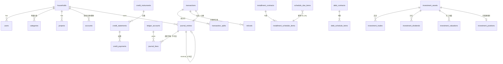

# TinyNest（小家）实施报告 · Phase 0 + V0.1

> 生成时间：2026-11-12（Asia/Shanghai）
> 分支：`feature/tinynest-phase0-v0.1`（**未合并 main，未 push**）
> 基准：`plan.md`（Phase 0）、`.plan/tinynest-phase0-cream-plan.md`、`.plan/tinynest-v0.1-implementation-plan.md`（已归档为 `docs/plan-v0.1.md`）
> 原则：不虚报测试结果；已实现 / 已测试 / 未测试 / 待确认 / 未实现 严格分开。

---

## 0. 范围说明（重要）

仓库根目录 `AGENTS.md` 与 `plan.md` 原本锁定「仅实现 Phase 0、不开发记账业务、完成后停止等待真实业务需求」。本次任务以用户明确指令 + 完整的 V0.1 实施计划作为**真实业务需求到达**，据此解除该范围冻结并继续实施 V0.1。Phase 0 原有实现（品牌图标、健康检查、部署模板、备份脚本、静态预览）**全部保留，未删除、未改绘**。

V0.1 实施计划第 18 节的 10 项账务口径，代码中按建议默认值实现原型，但**状态仍为「待确认」**，集中标注在 `docs/accounting-rules-v0.1.md` 第 8 节；正式用于真实家庭账务前必须由用户确认。

---

## 1. 完成的功能

### 1.1 Phase 0（已实现且已验证）
- PC 响应式奶油团子界面、iPhone PWA 骨架（manifest / 180·192·512 图标 / standalone / 安全区 viewport-fit=cover）。
- Service Worker **只缓存公开应用壳**，显式跳过 `/api/`；所有 API 响应 `Cache-Control: no-store`。
- Go 健康检查 `/api/v1/healthz`、`/api/v1/readyz`；V0.1 下 `readyz` 升级为**真实** `PRAGMA quick_check` + 迁移版本校验（不再谎称仅目录检查）。
- SQLite 元数据初始化、一致性备份脚本、双服务器 Nginx / systemd 模板（未写入任何真实 IP、域名、证书、口令）。
- 修复 Phase 0 遗留的真实构建缺陷：`vite.config.ts` 使用 `process.cwd()` 但缺 `@types/node`，改为 `loadEnv(mode, '.', 'VITE_')`，`npm run build` 首次真实通过。

### 1.2 V0.1 · S0（已实现）
- `docs/accounting-rules-v0.1.md`：五类科目表、20 类业务分录规则、3 张时序图、三套统计口径、10 项待确认清单。
- `docs/er-v0.1.md`：完整 ER 图、表清单、7 版本迁移策略、索引。
- `docs/api-v0.1.md`：统一错误结构、金额整数分约定、接口分组契约。

### 1.3 V0.1 · S1～S6（已实现并可运行）
| 阶段 | 已实现内容 |
|---|---|
| S1 | 单家庭单管理员登录（Argon2id）、HttpOnly/Secure/SameSite 会话 Cookie、写操作 CSRF 校验；16 个默认支出 + 4 个收入 + 投资分红分类（幂等种子）；两级分类新增；项目 CRUD 与项目累计收支；现金/证券/理财账户与期初余额（走期初权益）；余额**由分录重建** |
| S2 | 复式记账内核（借贷平衡双重校验、不可变分录、冲正）；支出/收入/转账；多分类拆分（合计严格等于总额）；流水查询/详情/冲正/退款；单事务提交与回滚；审计日志 |
| S3 | 信用卡/花呗/美团月付/抖音月付/自定义工具；自定义账单起止日、还款日与月偏移（处理 28/29/30/31 及闰年）；信用消费自动归集账单；部分/提前还款；平台金额核对差额；信用工具支付房贷的分录路径 |
| S4 | 全额/部分退款（关联原交易、累计不超额、指定拆分行）；分期合同与逐期计划（本金/手续费合计校验、末期承担尾差）；**幂等**的待支付事项生成（只生成 pending，不自动入账）；现金或信用工具支付期次；信用卡消费转分期的负债重分类（内核已实现） |
| S5 | 股票/ETF/理财资产；建仓/加仓/减仓/清仓统一由买卖方向 + 持仓推导；费用自动计算 + 单笔覆盖 + 费率快照；移动加权平均成本、已实现/未实现收益；分红（税额可空＝未知，不默认免税）；手工估值与估值日期 |
| S6 | 自然月/自定义周期；本期收入、支出、结余、**实际现金净流量**、本期应还负债、投资总收益、家庭净资产；未来 7/30 天待还；分类支出排行（一级自动汇总二级）；项目累计收支；各账户余额；投资收益与分红统计 |

### 1.4 前端（已实现）
`apps/web/src/App.vue` 已从「虚构数据 Demo」改为**全部连接真实 `/api/v1` 的账本界面**：登录/初始化、首页真实指标、快速记账、退款、冲正、账户、信用账单与还款、分期与待支付、投资买卖/分红/估值、持仓。页面不再出现模拟金额；未开发能力在设置页明确标注，不伪造保存成功。

---

## 2. 项目目录结构

```text
tinynest/
├── AGENTS.md / plan.md / README.md
├── IMPLEMENTATION_REPORT.md          # 本报告
├── .plan/                            # 两份原始实施计划（V0.1 计划原本未跟踪）
├── docs/
│   ├── DEVELOPMENT.md / architecture.md / design-system.md / security.md / deployment.md
│   ├── acceptance.md / agent-prompt.md / execution-report.md
│   ├── plan-v0.1.md                  # S0+ 归档的 V0.1 基准计划
│   ├── accounting-rules-v0.1.md      # S0 账务规则
│   ├── er-v0.1.md                    # S0 ER 图
│   └── api-v0.1.md                   # S0 API 契约
├── apps/api/                         # Go 模块化单体
│   ├── cmd/server/main.go            # 组合根：迁移 + 真实 readiness + 路由注册
│   ├── go.mod / go.sum               # modernc.org/sqlite（纯 Go，无 CGO）、golang.org/x/crypto
│   └── internal/
│       ├── money/                    # 整数分、half-up 舍入、定点数
│       ├── ledger/                   # 科目表、分录、20 类业务规则、冲正
│       ├── invest/                   # 移动加权平均成本、收益
│       ├── credit/                   # 账单周期与月末规则
│       ├── db/                       # 连接、7 版本迁移、分录持久化、余额重建
│       │   └── migrations/001..007.sql
│       ├── auth/                     # Argon2id、会话令牌
│       ├── api/                      # HTTP handlers + 端到端集成测试
│       └── server/                   # Phase 0 healthz/readyz（保留）
├── apps/web/                         # Vue 3 + TS + Vite
│   ├── src/App.vue / services/api.ts / styles.css
│   └── public/ manifest / sw.js / icons（原始团子图，未改绘）
├── assets/brand/                     # 用户原始图标 + SHA-256 说明
├── previews/                         # Phase 0 静态原型（保留）
├── scripts/                          # 品牌校验 / SQLite 初始化 / 备份 / 自检
└── deploy/frontend + deploy/backend  # 双服务器模板（占位符，无真实地址）
```

---

## 3. 数据库 ER 图

完整版见 `docs/er-v0.1.md`。核心关系：



共 7 个版本迁移、30 张业务表（含 `schema_migrations`），全部 `IF NOT EXISTS` / 幂等种子，启动时按版本顺序执行，失败整笔回滚，绝不无条件重建库。

---

## 4. 核心账务设计

- **唯一事实来源**：`journal_entries` + `journal_lines`；账户余额、负债、净资产、持仓成本均由分录聚合/可重建，页面不维护余额。
- **三分法**：消费（借费用 / 贷现金或信用负债）、资产转换（投资买卖）、负债结算（还款/期次付款）严格区分。
- **铁律**：单事务提交业务行 + 全部分录行 + 审计日志；借贷不平衡拒绝提交；已入账记录不物理删除，用取反冲正分录；退款关联原交易且累计不超额；定时任务 `biz_key` 唯一，只生成 pending。
- **精度**：金额整数分（`amount_minor`），数量/价格定点整数（`*_scaled`，scale=1e6），全程无 float；费用 `round-half-up` 并保存计算前金额、费率、最低费、最终费与费率快照。
- **三套口径分离**：收支（`4010:*` / `5010:*` + 利息/手续费/保险费用）、现金流（现金类资产科目净额，**排除期初余额**）、负债到期（期次/账单 `due_on`）；投资分红、已实现收益/损失、红利税归入「投资总收益」，不混入本期收支。

详见 `docs/accounting-rules-v0.1.md`。

---

## 5. API 接口概览

统一前缀 `/api/v1`，全部业务响应 `no-store`；写操作需 `X-CSRF-Token`；金额一律整数分。

| 分组 | 主要端点 |
|---|---|
| 认证 | `POST /setup`、`POST/DELETE /auth/session`、`GET /auth/me` |
| 基础 | `GET/POST /categories`、`GET/POST /projects`、`GET /projects/{id}/summary` |
| 账户 | `GET/POST /accounts`、`GET /accounts/{id}/balance` |
| 流水 | `GET/POST /transactions`、`GET /transactions/{id}`、`POST /transactions/{id}/reverse`、`POST /refunds`、`GET /refunds/by-transaction/{id}` |
| 信用 | `GET/POST /credit-instruments`、`GET /credit-statements`、`POST /credit-statements/{id}/payments`、`POST /credit-statements/{id}/reconcile` |
| 分期/负债 | `GET/POST /installments`、`POST /installments/{id}/payments`、`GET /schedule/due-items`、`POST /schedule/generate` |
| 投资 | `GET/POST /investments/assets`、`GET/POST /investments/trades`、`GET /investments/positions`、`POST /investments/dividends`、`POST /investments/valuations` |
| 首页 | `GET /dashboard/summary`、`/dashboard/categories`、`/dashboard/projects` |
| 基础设施 | `GET /healthz`、`GET /readyz` |

完整契约见 `docs/api-v0.1.md`。**部分计划中的端点尚未实现**，见第 8 节。

---

## 6. 前后端部署方法

### 本机开发
```bash
# 后端（B 机角色）
cd apps/api
mkdir -p data
TINYNEST_DATA_DIR=./data TINYNEST_DB_PATH=./data/tinynest.sqlite3 go run ./cmd/server
# 首次访问前端页面，用「首次初始化」创建家庭与管理员

# 前端（A 机角色）
cd apps/web
npm install && npm run dev     # http://127.0.0.1:5173，/api 代理到 127.0.0.1:8787
npm run build                  # 产出 dist/ 静态文件
```
生产构建：`go build -o tinynest-api ./cmd/server` + `npm run build`。

### 双服务器生产
- **A 机**：Nginx 托管 `apps/web/dist`，HTTPS 统一入口；`/api/v1/*` 经私网 TLS/VPN 反代到 B 机。模板：`deploy/frontend/nginx.conf.example`。**A 机不存放 SQLite、备份或密钥**。
- **B 机**：`tinynest-api` 由 systemd 托管，仅绑定 `127.0.0.1:8787`；私网 Nginx 8443 只放行 A 机私网 IP。模板：`deploy/backend/*`。数据库文件仅 B 机、权限 0600，备份异地加密。
- `TINYNEST_DATA_DIR` / `TINYNEST_DB_PATH` / `TINYNEST_LISTEN_ADDR` 通过环境变量注入；`.gitignore` 已排除 `*.sqlite3`、`/data/`、`/backups/`、`.env*`、`*.key/*.pem`。
- 升级：先备份 → 部署新二进制 → 启动时自动按版本迁移 → 检查 `/api/v1/readyz`。恢复步骤见 `scripts/backup-sqlite.py` 与 `docs/deployment.md`。

> ⚠️ 本次**没有**实际连接任何服务器、没有申请证书、没有打开公网端口，双服务器 HTTPS 与 iPhone Safari 实机安装均**未验证**。

---

## 7. 测试执行结果（真实执行，未虚报）

环境：Windows / Node v22.22.2 / npm 10.9.7 / Python 3.13.14。本机原本**没有 Go 工具链**，从阿里云镜像下载 Go 1.23.6 便携版解压到系统临时目录（**未修改系统 PATH、未写入仓库**），Go 依赖经 `https://goproxy.cn` 获取。

| # | 命令 | 结果 |
|---|---|---|
| 1 | `python scripts/verify-brand.py` | ✅ 通过：原始图与 Web 副本 SHA-256 一致，未改绘 |
| 2 | `python -m json.tool apps/web/public/manifest.webmanifest` | ✅ 通过 |
| 3 | `python scripts/init_sqlite.py --db <临时库>` + `PRAGMA quick_check` | ✅ 通过：仅 `schema_migrations`，journal_mode=WAL |
| 4 | `npm install`（apps/web，50 包） | ✅ 通过 |
| 5 | `npm run build`（`vue-tsc --noEmit && vite build`） | ✅ 通过：15 modules，dist 产出 index.html + CSS 15.14 kB + JS 112.34 kB |
| 6 | `go test ./...` | ✅ 全部通过：`api` / `credit` / `invest` / `ledger` / `money` / `server` |
| 7 | `go vet ./...` | ✅ 无输出（通过） |
| 8 | `go build ./...` 及 `go build -o tinynest-api.exe ./cmd/server` | ✅ 通过（15 MB 二进制） |
| 9 | `bash scripts/check-phase0.sh` | ✅ 通过（品牌 + Go test/vet + Vue build） |
| 10 | **真实进程 HTTP 联调**（启动编译后的二进制，curl 完整链路） | ✅ 通过，见下 |
| 11 | 端到端集成测试 `go test ./internal/api -v`（真实 SQLite + httptest） | ✅ 通过，见下 |

**集成测试覆盖**（`apps/api/internal/api/api_test.go`）：初始化/登录/CSRF/未认证拦截；期初余额；支出/收入/转账；拆分不匹配时业务行与分录**同时回滚**；信用消费不减现金 + 账单自动归集 + 部分还款；部分退款冲减原支出 + 超退拒绝；分期期次生成**重复执行不重复生成**；投资两次买入移动均价 11.05、部分卖出已实现收益 92.50、净分红 90.00、手工估值；首页三套口径字段；冲正后余额恢复且原分录保留；迁移重复执行为空操作。

**内核单元测试覆盖** V0.1 计划第 16 节用例 1–14、18–23、26、27、29（用例编号见 `rules_test.go` / `cost_test.go` / `cycle_test.go`）。

**真实进程联调关键输出**：
```
healthz 200 {"status":"ok","phase":"v0.1"}
readyz  200 {"check":"sqlite_quick_check_and_migrations"}
setup 201 → login 200 → me 200 → 默认分类 21 个
建账户(期初 1,000,000 分) → 记 100.00 支出 → 余额 990000 分
dashboard: income=0 expense=10000 cashflow=-10000 net_worth=990000
未认证访问 /accounts → 401
```

### 修复过程中发现并解决的真实缺陷（均有回归验证）
1. `vite.config.ts` 缺 `@types/node` 导致 `npm run build` 失败。
2. 单连接 SQLite 下，在 `rows` 未关闭时嵌套查询余额造成**死锁**（3 处 handler）。
3. `investment_trades.price_scaled` 违反 CHECK（API 未写入该列）。
4. `last_valued_on` 日期字符串被 Scan 成 int64 导致 500。
5. 首页 `4%`/`5%` 汇总把投资分红、已实现损益、红利税混入本期收支（**统计口径错误**）。
6. 期初余额被计入「本期实际现金净流量」。

### 未测试
- iPhone Safari 添加到主屏幕实机、独立窗口/启动画面/安全区实机表现。
- 生产 HTTPS、A→B 私网 TLS 链路、双服务器真实部署与连通性。
- 备份文件的**恢复演练**（脚本存在且冒烟通过 `--help`，但未对 V0.1 业务库做完整备份→恢复→账务一致性比对）。
- 前端交互自动化测试（仅做了类型检查与生产构建，未引入 E2E 框架）。
- 大数据量下的性能 / 流水分页压测。
- 真实浏览器 390 / 768 / 1440px 视觉实测（仅有 Phase 0 存档预览图）。

---

## 8. 未完成事项（明确标注「未实现」）

| 模块 | 未实现内容 |
|---|---|
| S3 | 账单状态自动流转（unbilled→billed→overdue）、信用额度已用/可用/使用率计算、`convert-to-installment` 的 HTTP 端点（**内核函数已实现并测试，未接线到 API**） |
| S4 | 房贷/贷款/保险等 `debt_contracts` 的 HTTP CRUD 与期次付款（表已建、待办生成已扫描该表）；分期提前结清、分期退款后未来期次调整 |
| S5 | 费率规则 `investment_fee_rules` 的写入 API（读取与快照已实现）；无份额概念的「金额份额模式」理财产品 |
| S6 | 资产负债构成变化、年度分红与税额的独立统计端点（分红数据已在持仓与汇总中） |
| S7 | 登录失败限流、真正的**每日定时调度器**（当前只有手动 `POST /schedule/generate`，但幂等已验证）、审计日志全覆盖、备份自动演练、PC/iPhone 实机验证、HTTPS/Nginx 实机部署、V0.1 发布说明文档 `docs/release-v0.1.md` |
| 通用 | 多家庭数据隔离（`handleGenerateDueItems` 未按 household_id 过滤期次；V0.1 单家庭下无影响）；部分写接口未接 `Idempotency-Key`；等额本息/等额本金计算器（计划明确列为 V0.1.x） |

> 按 V0.1 计划第 17.4 节发布门禁，上述未实现项 + 未测试项意味着 **V0.1 尚不能宣布正式发布完成**。本次交付的是账务内核正确、可运行、可记账、已通过自动化与真实进程验证的 V0.1 主体，不是已完成发布门禁的最终版。

---

## 9. 待确认 / 已知问题

**待确认（阻塞正式入账声明）**：`docs/accounting-rules-v0.1.md` 第 8 节 10 项口径（成员登录范围、现金账户范围、账单周期、分期确认时点、手续费分摊、移动加权平均成本法、手工估值、房贷每期拆分、收益率口径、退款跨月）。代码按建议默认值实现，但不得视为用户已确认。

**已知问题**：
1. 期初余额分录日期使用 UTC 当日，业务时区为 Asia/Shanghai，跨日边界可能相差一天。
2. 分期「部分付款」时手续费仅在结清该期的最后一笔确认，前期付款先冲本金（与「手续费按期确认」的理想口径有偏差）。
3. 红利税留空（未知）时，`gross_minor` 保存用户录入值而 `net_minor` 与之相同，页面需以 `tax_unknown` 标记展示，不得解读为免税。
4. 账单 `status` 目前只在还款时更新为 partial/paid，未随日期自动判定逾期。
5. `schedule/generate` 只生成未来 30 天内的待支付事项（这是设计行为，非缺陷），但缺少真正的每日自动触发。
6. 本机 Go 工具链位于系统临时目录，未加入 PATH；在具备标准 Go 环境的机器上直接 `go test ./...` 即可复现。
7. `apps/api/internal/server/server_test.go` 仅因 gofmt 格式化产生 diff，语义未变。

---

## 10. 后续 V0.2 建议（按优先级）

1. **补齐发布门禁**：完成第 7 节「未测试」清单，尤其备份→恢复账务一致性演练、iPhone Safari 实机、双服务器 HTTPS 私网链路实测。
2. **补齐 S4/S7 未实现项**：房贷/贷款/保险合同 API、提前结清、分期退款调整、真正的每日幂等调度器、登录限流、审计全覆盖。
3. **多家庭隔离与幂等收口**：为所有写接口统一接入 `Idempotency-Key`，并让所有查询强制带 `household_id`。
4. **口径确认闭环**：用户确认第 8 节 10 项后，把 `Assumption` 常量升级为正式业务规则并补充对应回归测试。
5. **前端质量**：引入 Vitest + Playwright，覆盖表单校验、金额格式化、日期边界与关键记账流程 E2E；补齐 390/768/1440 视觉回归。
6. **可观测性与运维**：结构化日志、迁移失败告警、备份校验自动化、健康检查细分到每项依赖。
7. 之后再评估实时行情、账单导入、预算、多成员权限、FIFO 成本法等 V0.2+ 能力；**不要**为预留引入 Redis/Kafka/微服务。

---

## 附：状态总表

| 状态 | 内容 |
|---|---|
| **已实现 + 已测试** | Phase 0 全部（含构建修复）、S0 设计、S1/S2 完整闭环、S3 信用账单核心、S4 退款与分期核心、S5 投资核心、S6 首页三套口径、前端真实 API 界面、7 版本迁移、认证/CSRF/审计基础 |
| **已实现 + 未测试** | 部分 handler 的边界分支、iPhone PWA 实机、双服务器部署模板的实际连通性 |
| **未测试** | 见第 7 节清单 |
| **待确认** | 第 9 节 10 项账务口径 |
| **未实现** | 见第 8 节表格；V0.1 发布门禁未全部通过 |
