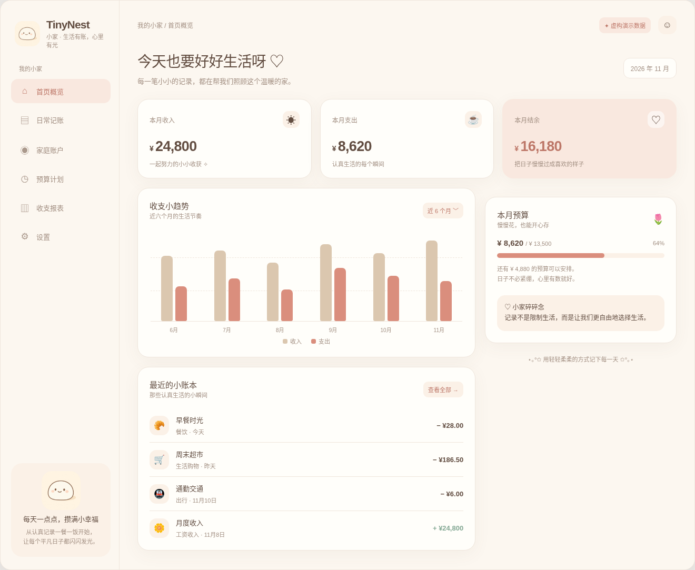
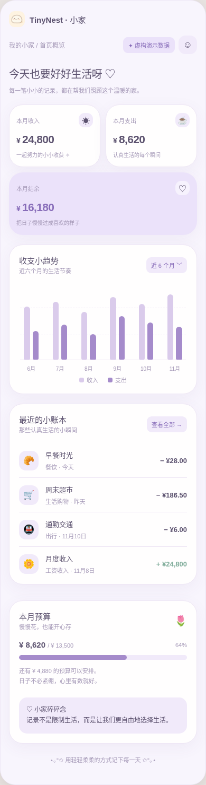

  

<h1 align="center">TinyNest · 小家</h1>

  <strong>让每一笔日常，都成为家的美好积累。</strong> 
  A thoughtful home for your family's finances.

  面向家庭的轻量化、自托管记账应用 
  PC Web · iPhone PWA · Self-hosted

  <strong>项目状态：V2 记账重置已完成代码与文档 · 生产清理与切库待用户执行 · 实机与生产验收未完成</strong>

---

## 项目进度与接手

当前基线是 **V2 记账重置**：保留身份/权限/家庭/邮件与复式记账内核，退役信用账单、分期、负债、投资、导入等模块，并把前端重建为手机优先的记账界面。范围、度量与未验证项见 [当前进度](docs/project-status.md)，启动与验证见 [开发说明](docs/DEVELOPMENT.md)。AI Agent 从 [AGENTS.md](AGENTS.md) 加载项目专属的 [高级开发工程师 Skill](.agents/skills/tinynest-senior-engineer/SKILL.md)。

## 现在能做什么

登录家庭账本后，当前版本提供以下真实能力（全部连接后端 `/api/v1`，没有虚构演示金额）：

| 能力 | 说明 |
| --- | --- |
| 日常记账 | 支出、收入与账户转账；4 列分类图标网格 + 自定义数字键盘，备注 / 日期 / 账户 / 成员 |
| 按天账单 | 按天分组与日小计；备注或分类名搜索；日历按日筛选；点行更正、长按或菜单删除（冲正） |
| 图表分析 | 环形图看分类占比，分类排行按金额降序；支出 / 收入与月 / 年切换 |
| 资产与转账 | 现金与信用卡两类账户、净资产汇总、账户之间行内转账；余额由分录自动重建 |
| 预算 | 按月单预算与进度条，超支如实显示 |
| 家庭成员 | 成员档案与当前成员切换；被引用的成员不允许物理删除 |
| 账单导出 | 选择月份与类型后在前端生成并下载 `.xlsx`，不新增导出接口 |
| 家庭与安全 | 邀请与审批、只读成员、管理员用户管理、审计日志、邮箱验证、密码修改与找回、登录失败限流 |

能力边界：V2 **不提供**信用卡账单、分期、利息、投资、股票、账单导入、退款、项目与家庭公告；信用卡账户只记录欠款，界面如实标注。账户余额由 `journal_lines` 派生，错账用冲正而不是改写历史。

## 关于 TinyNest

**TinyNest（小家）** 希望让家庭财务管理回归简单与清晰：从每天的收支记录出发，逐步建立家庭成员都能理解、共同维护的财务视图。

TinyNest 以 **简洁体验、家庭协作、数据自主掌控** 为长期设计方向，将温暖柔和的「奶油团子」视觉语言与实用、可扩展的技术架构结合。数据保存在用户自托管的数据库中，前端只请求同源 `/api` 相对路径，不接入第三方统计。

## 界面预览

当前使用 **A · 奶油团子（Cream Mochi）** 主题：奶油白、柔和杏粉与暖棕色，兼顾温馨氛围和长时间使用时的可读性。结构参照鲨鱼记账：底部 5 槽导航、中间凸起记账键、键盘式记账面板、按天账单、环形图与分类排行。

<table>
  <tr>
    <th align="center">PC Web</th>
    <th align="center">iPhone / PWA</th>
  </tr>
  <tr>
    <td align="center"></td>
    <td align="center"></td>
  </tr>
</table>

> **说明**：上方截图与 [`previews/open-directly.html`](previews/open-directly.html) 是 Phase 0 存档的**静态原型，金额均为虚构**，仅用于回顾视觉风格，不代表当前 `apps/web` 界面。当前应用的界面与交互以 `apps/web/src/` 代码和 Playwright 用例为准。

## 技术架构

TinyNest 采用前后端分离设计，面向个人及家庭自托管部署场景。

| 层级 | 当前工程选型 / 部署方向 |
| --- | --- |
| Web 客户端 | Vue 3 · TypeScript · Vite；路由使用 vue-router 4（V2 唯一新增依赖） |
| 移动端 | 响应式 Web · Progressive Web App（PWA），安全区与 44px 触控约束 |
| API 服务 | Go 模块化单体；55 条业务路由 + 健康检查；复式记账 API |
| 数据层 | SQLite（本地）或 MySQL 8（生产，仅 B 机，Unix socket）；V2 两个方言各 2 个迁移版本；运行时 26 张表 |
| 账务内核 | `journal_entries` / `journal_lines` 唯一事实来源；余额重建；已入账不可变，纠错用冲正 |
| 部署 | Nginx · Linux systemd · HTTPS 接入方案；前后端可分别部署在两台服务器 |

**数据自主掌控** 是架构目标：家庭数据保存在用户自有基础设施中。V2 已实现登录/会话/CSRF/审计、SQL 层家庭隔离、Asia/Shanghai 业务日期、显式 Cookie `Secure` 与登录失败限流、`schema_meta.baseline=v2` 基线守卫；生产清理、新库切换与真实环境验证仍需用户按手册执行。

## 开发进度

| 阶段 | 内容 | 状态 |
| --- | --- | --- |
| **Phase 0 · 工程初始化** | 品牌视觉、PC / iPhone Demo、前后端工程骨架、PWA 基础、部署模板 | **已完成并归档** |
| **V0.1 · 家庭财务核心账本** | 复式记账内核、认证与家庭隔离、信用/分期/投资等 V1 模块 | **已归档**（V1 报告见 [docs/reviews/v1-implementation-report.md](docs/reviews/v1-implementation-report.md)） |
| **V2 · 记账重置** | 模块收敛、运维清理 CLI、V2 数据层与 API、前端五界面重建、文档与验收 | **代码与文档完成**；生产清理/切库与实机验收待用户执行（`UNVERIFIED`） |
| **V2.1 · 可选** | `internal/api` 分包重构等维护性工作 | 未排期；不属于 V2 验收 |

V2 的 API 契约、数据模型与账务规则分别见 [docs/api-v2.md](docs/api-v2.md)、[docs/er-v2.md](docs/er-v2.md)、[docs/accounting-rules-v2.md](docs/accounting-rules-v2.md)；生产执行以 [清理手册](docs/plans/v2-prod-purge-runbook.md) 与 [切换手册](docs/plans/v2-cutover-runbook.md) 为准。

## 开发与参与

V2 代码已就位，但**生产环境尚未完成清理与切库**，在用户按手册执行并验证之前，不建议把真实家庭财务数据录入生产实例。

- **开发和本地启动说明：** [`docs/DEVELOPMENT.md`](docs/DEVELOPMENT.md)
- **当前进度与未验证项：** [`docs/project-status.md`](docs/project-status.md)
- **设计规范：** [`docs/design-system.md`](docs/design-system.md)
- **系统架构：** [`docs/architecture.md`](docs/architecture.md)
- **部署规划：** [`docs/deployment.md`](docs/deployment.md)
- **安全底线：** [`docs/security.md`](docs/security.md)

项目仍处于早期阶段，欢迎通过 Issue 提出产品建议、使用体验反馈或技术改进意见。涉及安全敏感信息时，请勿在公开 Issue 中提交口令、密钥、账单或个人财务数据。

---

  <strong>TinyNest · 小家</strong> 
  把日子认真记录，把生活温柔收藏。

