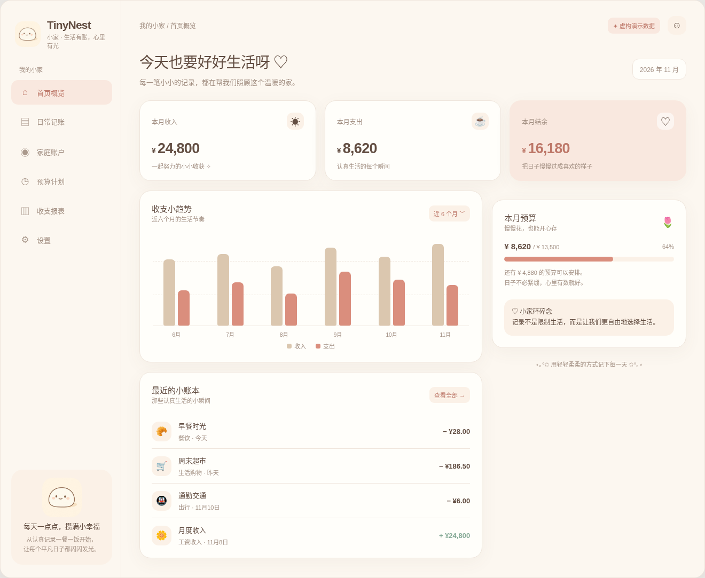
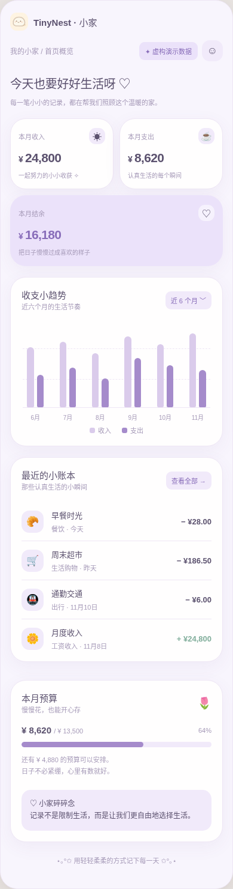

  

<h1 align="center">TinyNest · 小家</h1>

  <strong>让每一笔日常，都成为家的美好积累。</strong> 
  A thoughtful home for your family's finances.

  面向家庭的轻量化、自托管财务管理应用 
  PC Web · iPhone PWA · Self-hosted

  <strong>项目状态：V0.1 主体已实现 · 发布门禁尚未全部通过</strong>

---

## 项目进度与接手

当前开发基线为 main。项目状态见 [当前进度](docs/project-status.md)，AI Agent 从 [AGENTS.md](AGENTS.md) 开始。

## 关于 TinyNest

**TinyNest（小家）** 希望让家庭财务管理回归简单与清晰：从每天的收支记录出发，逐步建立家庭成员都能理解、共同维护的财务视图。

我们相信，记账不只是记录数字，更是理解日常生活、管理共同目标，以及为未来做好准备的一种方式。

TinyNest 以 **简洁体验、家庭协作、数据自主掌控** 为长期设计方向，将温暖柔和的「奶油团子」视觉语言与实用、可扩展的技术架构结合。

## 产品方向

以下是 **规划中的产品能力**，并非当前已上线功能：

| 方向 | 规划能力 |
| --- | --- |
| **日常记账** | 收入、支出与转账记录，分类、标签及收支分析 |
| **家庭协作** | 家庭成员、共享账本与个人账本，清晰的访问权限 |
| **预算与目标** | 日常预算、周期性支出、储蓄目标和趋势观察 |
| **资产视图** | 现金、银行卡、信用卡及其他家庭资产与负债的统一管理 |
| **自动化** | 在授权与安全机制完善后，逐步探索账单导入、对账和自动分类 |
| **智能洞察** | 在数据质量与隐私保护具备基础后，探索家庭财务分析与辅助决策 |

## 界面预览

当前使用 **A · 奶油团子（Cream Mochi）** 主题：奶油白、柔和杏粉与暖棕色，兼顾温馨氛围和长时间使用时的可读性。

<table>
  <tr>
    <th align="center">PC Web</th>
    <th align="center">iPhone / PWA</th>
  </tr>
  <tr>
    <td align="center"></td>
    <td align="center"></td>
  </tr>
</table>

> **说明**：上方截图与 [`previews/open-directly.html`](previews/open-directly.html) 是 Phase 0 存档的**静态原型，金额均为虚构**。`apps/web` 现已连接真实后端 API，可完成登录、记账、退款、信用账单、分期与投资记录；详见 [`docs/DEVELOPMENT.md`](docs/DEVELOPMENT.md)。
>
> V0.1 已实现复式记账内核与真实 SQLite 持久化；备份恢复已在隔离库演练通过，但 iPhone 实机、双服务器 HTTPS 与前端 E2E 尚未验证，10 项账务口径仍待确认，**暂不建议录入真实家庭财务数据**。

## 技术架构

TinyNest 采用前后端分离设计，面向个人及家庭自托管部署场景。

| 层级 | 当前工程选型 / 部署方向 |
| --- | --- |
| Web 客户端 | Vue 3 · TypeScript · Vite |
| 移动端 | 响应式 Web · Progressive Web App（PWA） |
| API 服务 | Go 模块化单体：健康检查 + V0.1 家庭账本 API |
| 数据层 | SQLite（仅 B 机）：7 版本迁移、复式分录持久化、余额由分录重建 |
| 部署 | Nginx · Linux systemd · HTTPS 接入方案 |
| 服务架构 | 前端静态资源与后端 API 可分别部署在两台服务器 |

**数据自主掌控** 是架构目标：家庭数据保存在用户自有的后端基础设施中，前端通过统一入口访问服务。登录/会话/CSRF/审计、家庭数据隔离、业务日期统一、生产 Cookie `Secure` 与登录失败限流已实现；正式投入使用前仍需完成生产 HTTPS 实机验证、细粒度权限、前端 E2E 与 10 项账务口径确认。

## 开发进度

| 阶段 | 内容 | 状态 |
| --- | --- | --- |
| **Phase 0 · 工程初始化** | 品牌视觉、PC / iPhone Demo、前后端工程骨架、PWA 基础、部署模板 | **已完成并验证** |
| **V0.1 · 家庭财务核心账本** | 复式记账内核、分类/项目/账户、信用账单、退款与分期、投资、首页统计 | **主体已实现并测试**；发布门禁未全部通过，见 [`IMPLEMENTATION_REPORT.md`](IMPLEMENTATION_REPORT.md) |
| **V0.2 · 发布门禁与增强** | 实机/HTTPS 验证、备份恢复自动化演练脚本、房贷保险 API、每日定时任务、多成员权限 | 待办 |
| **后续 · 自动化与智能化** | 账单导入、自动对账、实时行情及智能分析能力 | 探索中 |

路线图仅用于表达设计方向，功能范围和交付时间将在后续开发中逐步确认。

## 开发与参与

本仓库目前面向早期开发与原型验证，尚不建议用于存储真实家庭财务信息或部署为生产记账服务。

- **开发和本地启动说明：** [`docs/DEVELOPMENT.md`](docs/DEVELOPMENT.md)
- **设计规范：** [`docs/design-system.md`](docs/design-system.md)
- **系统架构：** [`docs/architecture.md`](docs/architecture.md)
- **部署规划：** [`docs/deployment.md`](docs/deployment.md)
- **问题与建议：** [GitHub Issues](https://github.com/Sunywr/tinynest/issues)

项目仍处于早期阶段，欢迎通过 Issue 提出产品建议、使用体验反馈或技术改进意见。涉及安全敏感信息时，请勿在公开 Issue 中提交口令、密钥、账单或个人财务数据。

---

  <strong>TinyNest · 小家</strong> 
  把日子认真记录，把生活温柔收藏。

