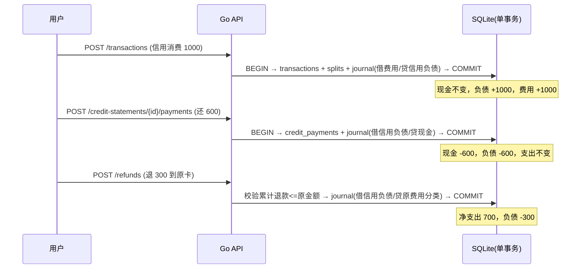
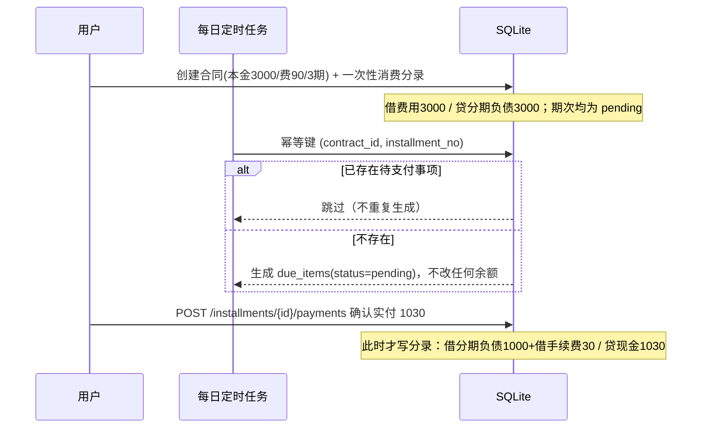
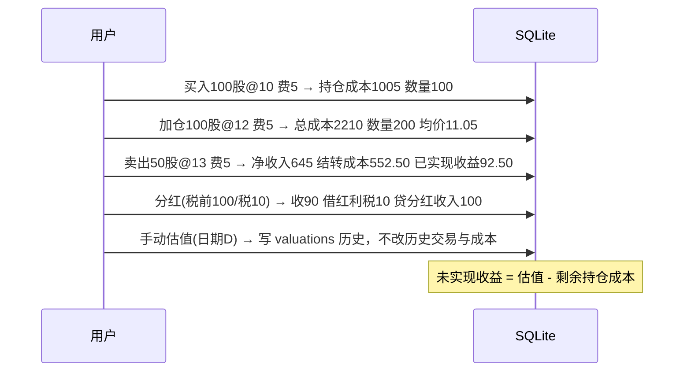

# TinyNest V0.1 · S0 账务设计基线（复式记账内核）

> 状态：**设计基线 · 已冻结口径，待用户确认第 8 节默认值**
> 依据：[`docs/plan-v0.1.md`](plan-v0.1.md) 第 3、13、16、18 节（V0.1 权威实施计划）
> 原则：任何页面操作不得直接改余额；所有余额由 `journal_lines` 重建。金额一律整数分。

---

## 1. 记账主体与三条铁律

1. **单一事实来源**：`journal_entries` + `journal_lines` 是唯一账务事实；业务表（`transactions`、`refunds`、`credit_payments`…）只表达用户意图与状态。
2. **单事务提交**：一条业务记录与其全部分录行、审计日志，必须在同一个 SQLite 事务内写入或同时回滚。
3. **不可变 + 冲正**：已入账分录不 UPDATE、不 DELETE；纠错 = 生成一条借贷取反的冲正分录（`reversal_of`）+ 新建正确业务记录。

派生余额（账户余额、信用负债、分期剩余本金、净资产）一律由分录聚合计算，允许缓存投影但必须可重建。

---

## 2. 科目表（`ledger_accounts`）

编码首位即类别：`1` 资产 / `2` 负债 / `3` 权益 / `4` 收入 / `5` 费用。
资产、费用借方增加；负债、权益、收入贷方增加。

| 编码 | 科目 | 类别 | 说明 |
|---|---|---|---|
| `1010` | 现金类账户 | 资产 | 按 `accounts.id` 建子科目，一账户一科目 |
| `1020` | 证券资金账户 | 资产 | 按证券账户建子科目 |
| `1030` | 理财现金账户 | 资产 | 按理财账户建子科目 |
| `1040` | 股票持仓 | 资产 | 按 `investment_assets.id` 建子科目，成本计价 |
| `1050` | ETF / 场内基金持仓 | 资产 | 同上 |
| `1060` | 理财产品持仓 | 资产 | 同上 |
| `1070` | 其他应收 | 资产 | 预留 |
| `2010` | 信用工具负债 | 负债 | 按 `credit_instruments.id` 建子科目，**一工具一科目** |
| `2020` | 分期本金负债 | 负债 | 按 `installment_contracts.id` 建子科目 |
| `2030` | 贷款本金负债 | 负债 | 按 `debt_contracts.id` 建子科目（房贷/其他贷款） |
| `2040` | 应付利息 / 手续费 | 负债 | 已计提未付时使用 |
| `3010` | 期初权益 | 权益 | 期初余额与期初负债的唯一对方科目，**不进收入** |
| `4010`–`4040` | 工资 / 报销 / 红包 / 利息 | 收入 | 默认收入分类 |
| `4050` | 投资分红收入 | 收入 | 仅由投资模块生成，不并入普通利息 |
| `4060` | 已实现投资收益 | 收入 | 卖出净收入 > 结转成本的部分 |
| `4090` | 其他收入 | 收入 | 自定义 |
| `5010`–`5099` | 支出分类科目 | 费用 | 16 个默认大类 + 用户自定义，二级分类建子科目 |
| `5100` | 利息费用 | 费用 | 房贷/贷款利息、分期利息 |
| `5110` | 手续费费用 | 费用 | 分期手续费、平台服务费 |
| `5120` | 保险费用 | 费用 | 保费 |
| `5130` | 红利税 | 费用 | 用户填写税额时 |
| `5190` | 已实现投资损失 / 其他费用 | 费用 | 卖出亏损、杂项 |

**不计入费用科目的项目**：投资买入费用（资本化进 `1040/1050/1060` 成本）、卖出费用（冲减卖出净收入）、自有账户互转、贷款本金、信用卡还款、分期本金结清。

---

## 3. 核心业务分录规则（全部借贷平衡）

记号：`A*` 资产、`L*` 负债、`E*` 权益、`R*` 收入、`X*` 费用；金额单位=分。

| # | 业务事件 | 借方 | 贷方 | 关键约束 |
|---|---|---|---|---|
| 1 | 现金账户期初余额 `v` | `1010` v | `3010` v | 期初不进收入 |
| 2 | 信用工具期初欠款 `v` | `3010` v | `2010` v | 期初不进费用 |
| 3 | 现金支出 `v`（分类 C） | `X_C` v | `A_付款账户` v | 现金减少 |
| 4 | 信用消费 `v`（分类 C） | `X_C` v | `L_信用工具` v | **现金不变**，负债增加 |
| 5 | 收入 `v`（分类 C） | `A_收款账户` v | `R_C` v | |
| 6 | 自有账户互转 `v` | `A_转入` v | `A_转出` v | 净资产、收入、支出均不变 |
| 7 | 偿还信用卡 `v` | `L_信用工具` v | `A_现金` v | **不重复计入支出** |
| 8 | 退款退回现金 `v` | `A_现金` v | `X_原分类` v | 冲减原支出，非收入 |
| 9 | 退款退回信用工具 `v` | `L_信用工具` v | `X_原分类` v | 减负债，冲减原支出 |
| 10 | 投资买入 `金额+费用` | `A_持仓` (gross+fee) | `A_资金账户` (gross+fee) | 资产转换，非消费；费用资本化 |
| 11a | 投资卖出盈利 | `A_资金账户` (net) | `A_持仓` (结转成本) + `4060` (差额) | 本金非收入 |
| 11b | 投资卖出亏损 | `A_资金账户` (net) + `5190` (差额) | `A_持仓` (结转成本) | |
| 12 | 分红（税前 `g`，税 `t`，实收 `g-t`） | `A_到账` (g-t) + `5130` (t) | `4050` (g) | 税额留空时按实收额入账并标记 `tax_unknown` |
| 13 | 房贷还款（现金，本金 `p` 利息 `i`） | `L_贷款` p + `5100` i | `A_现金` (p+i) | 只有利息是费用 |
| 14 | 房贷用信用卡支付（同上） | `L_贷款` p + `5100` i | `L_信用工具` (p+i) | 现金不变；见验收用例 10 |
| 15 | 创建分期（本金 `p`，一次性确认消费） | `X_原分类` p | `L_分期` p | 手续费**不预提**，按期确认 |
| 16 | 分期每期现金支付（本金 `p` 费 `f`） | `L_分期` p + `5110` f | `A_现金` (p+f) | |
| 17 | 分期每期信用支付 | `L_分期` p + `5110` f | `L_信用工具` (p+f) | 现金不变 |
| 18 | 信用卡消费「转分期」重分类 | `L_信用工具` p | `L_分期` p | **禁止两份本金并存** |
| 19 | 保险缴费 `v` | `5120` v | `A_现金` 或 `L_信用工具` v | 不虚构贷款本金 |
| 20 | 冲正 | 原分录各行借贷互换 | | 原分录保留，`reversal_of` 关联 |

**铁律校验**：任一 `journal_entry` 的 `SUM(debit_minor) == SUM(credit_minor)`，不等则整笔事务回滚；写入前、事务提交前各校验一次。

---

## 4. 金额、数量与舍入

- 金额：`INTEGER` 存分（`amount_minor`）；API 用十进制字符串或整数分，**禁止 JSON 浮点数**。
- 数量：`quantity_scaled` + `quantity_scale`（默认 6 位小数，即 1 股 = 1_000_000）；价格用 `price_scaled` 同理。
- 费用：`fee = max(round_half_up(gross * rate_bps / 10000), min_fee_minor)`，保存 `gross_minor / rate_bps / min_fee / computed_fee / overridden_fee` 与费率快照 ID。
- 移动加权平均成本：`avg_cost_scaled = total_cost_minor * scale / total_qty_scaled`（整数运算 + half-up）；卖出结转成本 = `avg_cost * qty_sold`，最后一股清仓时把剩余成本全部结转，避免尾差。
- 所有除法在后端整数域完成，前端只格式化展示。

---

## 5. 关键时序

### 5.1 信用消费 → 账单 → 还款 → 退款

### 5.2 分期创建 → 定时任务 → 用户确认付款

### 5.3 投资买 → 加仓 → 减仓 → 分红 → 估值

---

## 6. 三套统计口径（不得混为一个数字）

| 口径 | 数据来源 | 日期字段 | 示例 |
|---|---|---|---|
| 收支 | `journal_lines` 中 `4xxx/5xxx` 科目净额 | 业务发生日 `occurred_on` | 信用卡买菜当天计支出 |
| 现金流 | `journal_lines` 中 `1010/1020/1030` 科目借贷净额 | 实际收付日 `occurred_on` | 信用卡还款日才产生现金流出 |
| 负债到期 | `credit_statements` / `*_schedule_items` | 约定应付日 `due_on` | 账单、房贷、分期按还款日 |

- 本期结余 = 本期收入 − 本期支出（收支口径）。
- 实际现金净流量 ≠ 本期结余。
- 家庭净资产 = `SUM(资产科目借方余额)` − `SUM(负债科目贷方余额)`（投资持仓按成本，估值另列）。
- 投资总收益 = 已实现收益 + 未实现收益 + 净分红；参考收益率 = 总收益 / 历史累计买入成本，**不称年化**。

---

## 7. 幂等、并发与可靠性

- 所有写接口支持 `Idempotency-Key` 请求头，按 `(household_id, key)` 唯一；重放返回首次结果。
- 定时任务幂等键：`(contract_id, installment_no)`、`(instrument_id, cycle_start, cycle_end)`。
- SQLite：`PRAGMA journal_mode=WAL; foreign_keys=ON; busy_timeout=5000;`，`BEGIN IMMEDIATE` 用于所有写事务；单实例写入。
- 分录不平衡、金额 ≤ 0、累计退款超额、拆分行合计 ≠ 总额、期次本金/手续费合计不符 → 拒绝并返回结构化错误，整笔回滚。

---

## 8. 待用户确认口径（实施按建议默认值，但正式入账前必须确认）

> 依据 V0.1 计划第 18 节。**以下 10 项当前状态均为 `待确认`**，代码中以 `Assumption` 常量集中标注，不得静默当作已确认事实。

| # | 事项 | 建议默认 | 状态 |
|---|---|---|---|
| 1 | 单家庭单管理员登录，其余成员仅为交易归属档案 | 是 | 待确认 |
| 2 | 银行卡/微信/支付宝余额统一归入现金类账户 | 是，多账户 + 子类型 | 待确认 |
| 3 | 账单周期按用户录入起止日/还款日，允许单期人工修正 | 是 | 待确认 |
| 4 | 分期创建时一次性确认完整消费，后续按期结清负债 | 是 | 待确认 |
| 5 | 分期手续费按期分摊计入对应月份费用 | 是 | 待确认 |
| 6 | 投资成本用移动加权平均法（非 FIFO） | 是 | 待确认 |
| 7 | 估值手工录入，不接实时行情 | 是 | 待确认 |
| 8 | 房贷/贷款每期本金利息由用户录入，不自动推算等额本息 | 是 | 待确认 |
| 9 | 收益率 = 总收益 / 累计买入成本，不称年化 | 是 | 待确认 |
| 10 | 退款跨月：现金流按实际退款日，项目净支出按原交易减累计退款 | 是 | 待确认 |

---

## 9. S0 验收自检

- [x] 科目体系覆盖资产/负债/权益/收入/费用五类，余额方向明确。
- [x] 20 类业务分录均给出借贷双方且平衡；用例 5/6/7/10/13/14/18 与计划第 16 节逐条对应。
- [x] 明确「消费 vs 资产转换 vs 负债结算」三分法，无重复入账路径。
- [x] 三套统计口径分离。
- [x] 待确认项未擅自写成「已确认」。
- [ ] 用户确认第 8 节 → **未确认，阻塞正式入账声明**。
