# TinyNest V0.1 · S0 数据模型 / ER 图

> 依据 V0.1 实施计划第 13 节。所有金额 `*minor` 为 INTEGER（分）；所有业务表带 `household_id`；时间以 UTC 存 `TEXT`，展示用 Asia/Shanghai。
> 迁移按版本号顺序执行，禁止启动时无条件重建库。

## 1. 实体关系图

```mermaid
erDiagram
    households ||--o{ household_members : has
    households ||--o{ users : has
    households ||--o{ categories : has
    households ||--o{ projects : has
    households ||--o{ accounts : has
    households ||--o{ ledger_accounts : owns
    households ||--o{ journal_entries : owns
    households ||--o{ transactions : owns
    households ||--o{ credit_instruments : owns
    households ||--o{ installment_contracts : owns
    households ||--o{ debt_contracts : owns
    households ||--o{ investment_assets : owns
    households ||--o{ investment_fee_rules : owns
    households ||--o{ audit_logs : owns

    categories ||--o{ categories : "parent_id (2级)"
    categories ||--o{ transaction_splits : classifies
    projects  ||--o{ transaction_splits : aggregates

    accounts ||--o{ ledger_accounts : "1:1 映射科目"
    accounts ||--o{ account_opening_balances : has

    transactions ||--|{ transaction_splits : "至少1行"
    transactions ||--o{ refunds : "原交易"
    transactions ||--o{ journal_entries : "业务->分录"
    journal_entries ||--|{ journal_lines : ">=2行,借贷平衡"
    journal_entries ||--o| journal_entries : "reversal_of 冲正"
    ledger_accounts ||--o{ journal_lines : posts

    credit_instruments ||--o{ credit_statements : generates
    credit_statements ||--o{ credit_statement_items : contains
    credit_statements ||--o{ credit_payments : settles
    credit_instruments ||--o{ ledger_accounts : "负债科目"

    installment_contracts ||--|{ installment_schedule_items : "N期"
    installment_schedule_items ||--o{ installment_payments : settles
    debt_contracts ||--|{ debt_schedule_items : "N期"
    debt_schedule_items ||--o{ debt_payments : settles
    schedule_due_items ||--o| installment_schedule_items : "待办投影"
    schedule_due_items ||--o| debt_schedule_items : "待办投影"

    investment_assets ||--o{ investment_trades : trades
    investment_assets ||--o{ investment_dividends : pays
    investment_assets ||--o{ investment_valuations : valued
    investment_assets ||--o| investment_positions : "可重建投影"
    investment_fee_rules ||--o{ investment_trades : "费率快照"
    investment_trades ||--o{ journal_entries : "业务->分录"
```

## 2. 表清单与关键约束

### 2.1 基础 / 权限

| 表 | 关键列 | 约束 |
|---|---|---|
| `households` | id, name, currency='CNY', timezone, created_at | 单家庭 |
| `users` | id, household_id, username, password_hash(Argon2id), role, status | 用户名唯一 |
| `sessions` | id, user_id, token_hash, csrf_token, expires_at, revoked_at | HttpOnly/Secure/SameSite |
| `household_members` | id, household_id, name, status | 仅交易归属，不登录 |
| `categories` | id, household_id, parent_id, kind(income/expense), name, level<=2, sort, active | 停用不删历史 |
| `projects` | id, household_id, name, start_on, end_on, note, status | 停用仍可查历史 |
| `audit_logs` | id, household_id, actor, action, entity, entity_id, payload_json, created_at | 只追加 |

### 2.2 账务内核

| 表 | 关键列 | 约束 |
|---|---|---|
| `ledger_accounts` | id, household_id, code, name, category(1-5), parent_code, ref_type, ref_id, active | `(household_id, code)` 唯一 |
| `journal_entries` | id, household_id, entry_no, biz_type, biz_id, occurred_on, memo, status(posted/reversed), reversal_of, idempotency_key, created_by, created_at | `idempotency_key` 唯一；**不可变** |
| `journal_lines` | id, entry_id, line_no, ledger_account_id, debit_minor, credit_minor, currency, memo | 单行只有一侧有值；`(entry_id,line_no)` 唯一 |
| `accounts` | id, household_id, kind(cash/securities/wealth), subtype, name, owner_member_id, ledger_account_id, status | 余额由分录重建 |
| `account_opening_balances` | id, account_id, amount_minor, entry_id | 对方科目固定 `3010` |
| `transactions` | id, household_id, type(expense/income/transfer), amount_minor, currency, occurred_on, account_id, credit_instrument_id, to_account_id, member_id, merchant, note, status(draft/posted/reversed), entry_id, idempotency_key | 拆分行合计=总金额 |
| `transaction_splits` | id, transaction_id, line_no, category_id, project_id, amount_minor, note | 未拆分也存 1 行 |
| `refunds` | id, household_id, transaction_id, split_id, amount_minor, refund_on, destination_type, destination_id, entry_id, note | 累计退款 ≤ 原拆分行金额 |

> 校验触发器/应用层双保险：`journal_entries` 提交前 `SUM(debit)=SUM(credit)`；业务表 `status=posted` 后不可物理删除。

### 2.3 信用与账单

| 表 | 关键列 |
|---|---|
| `credit_instruments` | id, household_id, kind(credit_card/huabei/meituan/douyin/custom), name, issuer, member_id, credit_limit_minor(NULL=未知), cycle_start_day, cycle_end_day, due_day, due_month_offset, ledger_account_id, status |
| `credit_statements` | id, instrument_id, cycle_start_on, cycle_end_on, due_on, system_due_minor, paid_minor, platform_amount_minor(NULL=未核对), status(unbilled/billed/partial/paid/overdue), note |
| `credit_statement_items` | id, statement_id, source_type, source_id, amount_minor, occurred_on |
| `credit_payments` | id, statement_id, amount_minor, paid_on, from_account_id, entry_id, idempotency_key |

### 2.4 分期与固定负债

| 表 | 关键列 |
|---|---|
| `installment_contracts` | id, household_id, source_transaction_id, name, principal_minor, total_fee_minor, periods, first_due_on, cycle, ledger_account_id, status |
| `installment_schedule_items` | id, contract_id, installment_no UNIQUE, due_on, principal_minor, fee_minor, total_minor, status(pending/partial/paid/overdue/cancelled), paid_minor |
| `installment_payments` | id, schedule_item_id, amount_minor, paid_on, channel(cash/credit), channel_id, entry_id, idempotency_key |
| `debt_contracts` | id, household_id, kind(mortgage/loan/insurance/other), name, principal_minor, remaining_principal_minor, start_on, end_on, cycle, due_day, default_channel, ledger_account_id, status |
| `debt_schedule_items` | id, contract_id, installment_no UNIQUE, due_on, principal_minor, interest_minor, fee_minor, total_minor, status, paid_minor |
| `debt_payments` | id, schedule_item_id, amount_minor, paid_on, channel, channel_id, entry_id, idempotency_key |
| `schedule_due_items` | id, household_id, source_type, source_id, **biz_key UNIQUE**, due_on, amount_minor, status(pending/confirmed/skipped) |

> `biz_key` 例：`installment:{contract_id}:{no}`、`debt:{contract_id}:{no}`、`statement:{statement_id}`。定时任务重复执行只 `INSERT OR IGNORE`，**绝不自动置为已付款**。

### 2.5 投资

| 表 | 关键列 |
|---|---|
| `investment_assets` | id, household_id, code, name, kind(stock/etf/wealth/custom), market, account_id, ledger_account_id, quantity_scale=6, status |
| `investment_fee_rules` | id, account_id, version, commission_bps, commission_min_minor, stamp_duty_bps, transfer_fee_bps, other_fee_rule_json, effective_from |
| `investment_trades` | id, household_id, asset_id, side(buy/sell), trade_on, quantity_scaled, price_scaled, gross_minor, fee_rule_id, fee_rule_snapshot_json, computed_fee_minor, fee_minor(最终), net_minor, from_account_id, entry_id, position_cost_before/after_minor, realized_pnl_minor, idempotency_key |
| `investment_dividends` | id, asset_id, ex_on, received_on, gross_minor, tax_minor NULL(未知), net_minor, to_account_id, entry_id |
| `investment_valuations` | id, asset_id, valued_on, price_scaled, market_value_minor, note |
| `investment_positions` | asset_id PK, quantity_scaled, total_cost_minor, avg_cost_scaled, last_valued_on | 可重建投影 |

## 3. 迁移策略

- `schema_migrations(version INTEGER PRIMARY KEY, description, applied_at)` 沿用 Phase 0，不重建。
- `001` 基础与权限 → `002` 科目与分录内核 → `003` 交易/拆分/退款 → `004` 信用账单 → `005` 分期/负债/待办 → `006` 投资 → `007` 索引与默认分类种子。
- 每次迁移前自动一致性备份；迁移在单事务内执行，失败回滚；提供 `migrate up / status` 与恢复说明。
- 默认 16 个支出 + 4 个收入分类由 `007` 以幂等 `INSERT OR IGNORE` 写入，用户改名/停用不被覆盖。

## 4. 索引（性能底线）

`journal_lines(entry_id)`、`journal_lines(ledger_account_id, entry_id)`、`journal_entries(household_id, occurred_on, biz_type)`、`transactions(household_id, occurred_on, status)`、`transaction_splits(category_id)`、`transaction_splits(project_id)`、`credit_statements(instrument_id, cycle_start_on)`、`*_schedule_items(due_on, status)`、`schedule_due_items(biz_key) UNIQUE`、`investment_trades(asset_id, trade_on)`。
