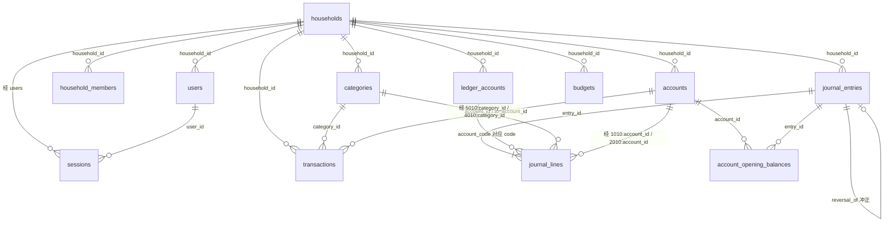

# TinyNest V2 · 数据模型与 ER

> 依据：`apps/api/internal/db/migrations/001_core.sql`（SQLite 21 张表）、`002_bookkeeping.sql`（SQLite 4 张表）、
> `apps/api/internal/db/mysql/` 下同名 MySQL 文件，以及 `internal/db/migrate.go` 创建的 `schema_migrations`。
> 数量口径：**25 张业务表**，加迁移账本 `schema_migrations` 后运行时 **26 张**；SQLite 与 MySQL 表集一致。
> 金额一律整数分（`*_minor`），业务日期为 Asia/Shanghai 的 `YYYY-MM-DD`，其余时间戳为 RFC3339 UTC 文本。

## 1. 分组与表清单

| 分组 | 张数 | 表 |
| --- | --- | --- |
| 身份与权限 | 15 | `households`、`users`、`sessions`、`household_members`、`household_invites`、`household_user_members`、`pending_registrations`、`site_administrators`、`email_identities`、`email_challenges`、`mail_configuration`、`mail_preferences`、`mail_daily_usage`、`mail_recipient_daily_usage`、`mail_queue` |
| 运营审计 | 1 | `audit_logs` |
| 复式记账内核 | 4 | `ledger_accounts`、`journal_entries`、`journal_lines`、`account_opening_balances` |
| 记账业务 | 4 | `categories`、`accounts`、`transactions`、`budgets` |
| 基线元数据 | 1 | `schema_meta`（`baseline=v2`） |

另：`schema_migrations` 由 Go 代码创建（不嵌入 DDL），记录 `version`、`description`、`applied_at`、`checksum`，是迁移器的账本，不计入 25 张业务表。

生产清理工具保留的 **11 张身份表** 为：`households`、`users`、`sessions`、`pending_registrations`、`site_administrators`、`email_identities`、`email_challenges`、`mail_configuration`、`mail_preferences`、`mail_daily_usage`、`mail_recipient_daily_usage`；`mail_queue` 与成员档案/邀请 3 张表按业务数据清空（成员档案清后由用户登录与 `/household/members/current` 重建）。

## 2. ER 关系

说明：

- `journal_lines` 不保存 `household_id`，家庭范围通过 `journal_entries.household_id` 继承；所有查询必须 `JOIN journal_entries` 后在 SQL 层限定家庭。
- `ledger_accounts.code` 与 `journal_lines.account_code` 是逻辑对应（科目编码字符串），不是数据库外键；具体编码规则见 [账务规则](accounting-rules-v2.md) §2。
- `household_invites`、`household_user_members`、`pending_registrations`、`site_administrators`、`email_*`、`mail_*`、`audit_logs`、`schema_meta` 在 DDL 中**没有**外键约束，由应用层维护关系（v1 起即如此，V2 未新增级联）。
- 所有表之间**不新增 `ON DELETE` 级联**：删除顺序显式处理（例如清理工具的 `internal/dbadmin/tables.go` 子表→父表顺序），避免隐式误删。

## 3. 身份与权限（15 张）

| 表 | 关键列 | 约束与说明 |
| --- | --- | --- |
| `households` | `id`、`name`、`currency`（默认 `CNY`）、`timezone`（默认 `Asia/Shanghai`）、`created_at` | 单家庭生产口径；ID 为 `hh_` 前缀 |
| `users` | `id`、`household_id`、`username`、`password_hash`、`role`、`status`、`email`、`avatar`、`birthday`、`payday`、`created_at` | `username` 全局唯一；`role` ∈ `admin`/`member`/`viewer`（DDL 无 CHECK）；`household_id` 外键 |
| `sessions` | `id`、`user_id`、`token_hash`、`csrf_token`、`expires_at`、`revoked_at`、`created_at` | `token_hash` 唯一；`user_id` 外键；索引 `idx_sessions_user` |
| `household_members` | `id`、`household_id`、`name`、`status`、`created_at` | 成员档案不登录；`status` 软删除；`household_id` 外键 |
| `household_invites` | `token_hash`（主键）、`household_id`、`member_id`、`target_username`、`expires_at`、`applicant`、`decided_at` | 48 小时有效；明文邀请码不落库 |
| `household_user_members` | `user_id`（主键）、`member_id`（唯一） | 登录账号与成员档案一对一绑定 |
| `pending_registrations` | `username`（主键）、`password_hash`、`created_at` | 待家庭管理员审批的注册 |
| `site_administrators` | `user_id`（主键） | 站点管理员白名单，普通家庭管理员无权配置 SMTP |
| `email_identities` | `email`（主键）、`owner`（唯一）、`verified_at` | 已验证邮箱与账号/待审批注册的绑定 |
| `email_challenges` | `id`、`owner`、`email`、`purpose`、`digest`、`attempts`、`created_at`、`expires_at`、`consumed` | 验证码只存 HMAC 摘要；索引 `email_challenge_owner(owner,purpose,created_at)` |
| `mail_configuration` | `id`（固定 1）、`version`、`config_json`、`password_cipher`、`updated_at` | SMTP 配置；口令为 AES-GCM 密文；`version` 用于并发保存冲突 |
| `mail_preferences` | `user_id`（主键）、`announcements` | 邮件订阅偏好（不代表家庭公告功能） |
| `mail_daily_usage` | `day`（主键）、`total`、`announcements` | 全站每日发信计数，按 Asia/Shanghai 日期 |
| `mail_recipient_daily_usage` | `day`、`email`、`total`，主键 `(day,email)` | 同一收件邮箱每日最多 3 封 |
| `mail_queue` | `id`、`household_id`、`user_id`、`recipient`、`kind`、`payload`、`status`、`attempts`、`due_at`、`expires_at`、`created_at` | 密文正文；worker 每 2 秒处理；索引 `mail_queue_status(status,due_at)` |

## 4. 运营审计（1 张）

| 表 | 关键列 | 约束与说明 |
| --- | --- | --- |
| `audit_logs` | `id`（自增）、`household_id`、`actor`、`action`、`entity`、`entity_id`、`payload_json`、`created_at` | 只追加；索引 `idx_audit_household(household_id,created_at)`；不迁移 V1 历史数据 |

## 5. 复式记账内核（4 张）

| 表 | 关键列 | 约束与说明 |
| --- | --- | --- |
| `ledger_accounts` | `id`、`household_id`、`code`、`name`、`category`、`ref_type`、`ref_id`、`active` | `UNIQUE(household_id, code)`；`category` CHECK 1–5（1 资产 / 2 负债 / 3 权益 / 4 收入 / 5 费用）；`household_id` 外键 |
| `journal_entries` | `id`、`household_id`、`biz_type`、`biz_id`、`occurred_on`、`currency`、`memo`、`status`、`reversal_of`、`idempotency_key`、`created_by`、`created_at` | `status` CHECK `posted`/`reversed`；`reversal_of` 自引用；`idempotency_key` 唯一；索引 `idx_entries_household_date`、`idx_entries_biz` |
| `journal_lines` | `id`（自增）、`entry_id`、`line_no`、`account_code`、`debit_minor`、`credit_minor`、`memo` | `entry_id` 外键；`UNIQUE(entry_id, line_no)`；CHECK 单行只有借或贷一侧为正；索引 `idx_lines_entry`、`idx_lines_account(account_code, entry_id)` |
| `account_opening_balances` | `id`、`account_id`、`amount_minor`、`entry_id` | 记录账户期初余额与对应分录；`amount_minor > 0`；`entry_id` 外键 |

关键不变量：

- 每条 `journal_entries` 至少 2 条 `journal_lines`，且 `SUM(debit_minor) = SUM(credit_minor)`、总额 > 0；写入前由 `ledger.Entry.Validate()` 校验，整笔事务失败即回滚。
- 已入账分录不可变：不 UPDATE / DELETE；纠错只能新增冲正分录。
- `journal_lines` 没有 `household_id`，家庭范围由 `journal_entries` 决定。

## 6. 记账业务（4 张）

| 表 | 关键列 | 约束与说明 |
| --- | --- | --- |
| `categories` | `id`、`household_id`、`kind`、`name`、`emoji`、`color`、`sort`、`active`、`created_at` | `kind` CHECK `income`/`expense`；单层分类，无 `parent_id`；`active`：1 启用、0 停用、-1 已删除；索引 `idx_categories_household(household_id,kind,active,sort)` |
| `accounts` | `id`、`household_id`、`kind`、`subtype`、`name`、`owner_member_id`、`ledger_code`、`status`、`note`、`created_at` | `kind` CHECK `cash`/`credit`；`UNIQUE(household_id, ledger_code)`；`status` ∈ `active`/`disabled`/`deleted`；`ledger_code` 指向 `journal_lines.account_code` |
| `transactions` | `id`、`household_id`、`type`、`amount_minor`、`currency`、`occurred_on`、`category_id`、`account_id`、`to_account_id`、`member_id`、`note`、`status`、`entry_id`、`idempotency_key`、`created_by`、`created_at` | `type` CHECK `expense`/`income`/`transfer`；`amount_minor > 0`；`status` CHECK `posted`/`reversed`；`idempotency_key` 唯一；索引 `idx_tx_household_date`、`idx_tx_category`、`idx_tx_account` |
| `budgets` | `household_id`、`month`、`amount_minor` | 主键 `(household_id, month)`；`month` 为 `YYYY-MM`；`amount_minor` 由 API 校验 ≥0，DDL 无 CHECK；未设置预算时没有行（读取返回 `null`） |

约束与约定：

- 流水只保存 `category_id`，不保存分类名称/emoji 快照；分类改名即时反映到历史流水，删除分类为软删除。
- `transactions.entry_id` 指向同事务写入的 `journal_entries`；不允许只写流水不写分录。
- `transactions.idempotency_key` 为全局唯一约束；幂等回放查询按 `(idempotency_key, household_id)`。
- 期初余额同时写 `journal_entries` + `journal_lines` 与 `account_opening_balances`，对方科目为 `3010` 期初权益。

## 7. 基线元数据（1 张）

| 表 | 关键列 | 说明 |
| --- | --- | --- |
| `schema_meta` | `meta_key`（主键）、`value` | 记录 `baseline=v2`；启动时守卫读取，缺失或不是 `v2` 直接拒绝启动 |

## 8. 方言差异（SQLite ↔ MySQL）

| 项 | SQLite | MySQL 8 |
| --- | --- | --- |
| 类型 | `TEXT` / `INTEGER` | `VARCHAR(191)` / `BIGINT` / `TEXT` / `MEDIUMTEXT` |
| 时间默认值 | `strftime('%Y-%m-%dT%H:%M:%fZ','now')` | `DATE_FORMAT(UTC_TIMESTAMP(6),'%Y-%m-%dT%H:%i:%s.%fZ')` |
| 自增主键 | `INTEGER PRIMARY KEY AUTOINCREMENT` | `BIGINT PRIMARY KEY AUTO_INCREMENT` |
| 外键 | 全部声明（含 `account_opening_balances.account_id -> accounts`） | `account_opening_balances.account_id` **不声明**外键（`accounts` 由 `002_bookkeeping.sql` 创建，MySQL 要求外键目标先存在；由应用层保证） |
| 索引 | `CREATE INDEX` 独立语句 | 全部内联在 `CREATE TABLE` 中（迁移文件必须可重跑） |
| 字符集/排序 | 默认 | `utf8mb4` + `utf8mb4_0900_bin` |

其余外键（`household_id`、`user_id`、`category_id`、`account_id`、`to_account_id`、`entry_id`、`reversal_of` 等）在两个方言中均已声明；`mail_queue`、`audit_logs`、邀请/邮件身份等表两方言都**没有**外键。

## 9. 冲正不变量

1. `journal_entries.status` 只有 `posted` / `reversed`；冲正分录的 `reversal_of` 指向原分录，`biz_type=reversal`，`biz_id` 沿用原业务 ID。
2. 冲正分录的行由原分录逐行借贷互换生成（`debit ↔ credit`），因此借贷仍平衡、原业务净额归零。
3. 冲正分录的 `occurred_on` **沿用原分录日期**，保证跨月/跨期统计在同一期间相互抵消，不把更正泄漏到另一期。
4. 原分录只把 `status` 改为 `reversed`，从不 UPDATE 金额或删除行；`transactions.status` 同步改为 `reversed`。
5. 删除流水 = 冲正；更正（PATCH）= 同一事务内「冲正原流水 + 写入替换流水」；已冲正流水再次操作返回 409。
6. 统计只对 `journal_lines` 求和，因此冲正后收入/支出/预算已用自动净额归零，无需额外回写。
7. 账户余额 = `SUM(debit_minor - credit_minor)` 按 `account_code` + 家庭范围聚合；信用卡账户余额为负表示欠款。

对应实现：`internal/ledger/entry.go`（`Validate` / `Reverse`）、`internal/api/transactions.go`（`reversePosted`、更正与删除）、`internal/api/stats.go`（派生统计）。

## 10. 迁移策略

- 每个方言只有版本 1–2：`001_core.sql` 建身份、审计与内核 21 张表；`002_bookkeeping.sql` 建记账 4 张表。
- 迁移器按文件名前 3 位版本升序应用，记录 SHA-256 校验和并校验连续性；SQLite 整文件单事务，MySQL 逐条执行且文件必须可重跑。
- 新库由 V2 二进制从零建立 `schema_meta.baseline=v2`；V1 旧库不升级，按 [新库切换手册](plans/v2-cutover-runbook.md) 处理。
- 默认分类由 Go 常量 `db.DefaultCategories` + `db.SeedForHousehold()` 幂等写入，不使用 SQL 种子文件。

## 11. 索引与性能底线

| 索引 | 服务对象 |
| --- | --- |
| `journal_entries(household_id, occurred_on, biz_type)` | 统计与流水的家庭+日期范围过滤 |
| `journal_entries(biz_type, biz_id)` | 业务对象与分录互查 |
| `journal_lines(entry_id)` | 分录明细回读 |
| `journal_lines(account_code, entry_id)` | 账户余额重建与账户流水 |
| `transactions(household_id, occurred_on, status)` | 账单按天分组与分页 |
| `transactions(household_id, category_id, occurred_on)` | 分类筛选与分类统计 |
| `transactions(account_id, occurred_on)` | 账户流水 |
| `categories(household_id, kind, active, sort)` | 分类网格与选择器 |
| `sessions(user_id)`、`audit_logs(household_id, created_at)`、`mail_queue(status, due_at)`、`email_challenges(owner, purpose, created_at)` | 会话吊销、审计查询、邮件 worker、验证码校验 |

统计与余额查询都保留 `household_id` 条件，避免跨家庭扫描；V2 未新增物化视图或缓存表，统计每次从分录聚合。
