# TinyNest V2 · 数据模型与 ER

> 依据：`apps/api/internal/db/migrations/`（SQLite）与 `apps/api/internal/db/mysql/`（MySQL）下同名 `001`–`013` 共 **13 个迁移文件**：
> `001_core.sql`（身份、审计与内核）、`002_bookkeeping.sql`（记账 4 张表）、`003_category_style.sql`（分类颜色）、`004_credit_cycle.sql`（信用卡账单日/还款日）、
> `005_investments.sql`（证券/理财估值快照 2 张表）、`006_auth_login_locks.sql`、`007_project_budgets.sql`、`008_transaction_source_metadata.sql`、
> `009_credit_statement_mailboxes.sql`、`010_credit_statement_bindings.sql`、`011_statement_mailbox_providers.sql`、`012_card_statements.sql`、
> `013_statement_placeholders.sql`（待补明细占位 1 张表），
> 以及 `internal/db/migrate.go` 创建的 `schema_migrations`。
> 数量口径（2026-11-26 在含 `013` 的工作树上实测：SQLite 空库迁移 13 个版本后逐张清点，MySQL 8.4.7 隔离实例同口径）：**38 张表**（含基线元数据 `schema_meta`），加迁移账本 `schema_migrations` 后 MySQL 运行时 **39 张**；SQLite 另因 `AUTOINCREMENT` 多出 `sqlite_sequence`，空库迁移后为 **40 张**。`91b47c9` 记录的 37/38/39 是加入 `013` 之前的口径。两方言业务表集一致。
> 金额一律整数分（`*_minor`），业务日期为 Asia/Shanghai 的 `YYYY-MM-DD`，其余时间戳为 RFC3339 UTC 文本。投资持仓的份额/价格缩放 1e6，收益率为基点（10000 = 100%）。

## 1. 分组与表清单

| 分组 | 张数 | 表 |
| --- | --- | --- |
| 身份与权限 | 15 | `households`、`users`、`sessions`、`household_members`、`household_invites`、`household_user_members`、`pending_registrations`、`site_administrators`、`email_identities`、`email_challenges`、`mail_configuration`、`mail_preferences`、`mail_daily_usage`、`mail_recipient_daily_usage`、`mail_queue` |
| 运营审计 | 1 | `audit_logs` |
| 登录风控 | 1 | `auth_login_locks`（迁移 006） |
| 复式记账内核 | 4 | `ledger_accounts`、`journal_entries`、`journal_lines`、`account_opening_balances` |
| 记账业务 | 4 | `categories`、`accounts`、`transactions`、`budgets` |
| 项目预算 | 2 | `project_budgets`、`transaction_budget_links`（迁移 007） |
| 流水来源元数据 | 1 | `transaction_source_metadata`（迁移 008） |
| 账单邮箱与绑卡 | 4 | `credit_statement_mailboxes`（009）、`credit_statement_bindings`（010）、`statement_mailbox_configs`（011）、`statement_mailbox_card_links`（011） |
| 银行账单汇总 | 2 | `card_statements`、`card_statement_sources`（012，只读对账） |
| 待补明细占位 | 1 | `statement_placeholders`（013，银行账单 ↔ 占位流水的一对一关联） |
| 投资估值快照 | 2 | `investment_accounts`、`investment_holdings`（只读 pfm 导入，不写分录） |
| 基线元数据 | 1 | `schema_meta`（`baseline=v2`） |
| **合计** | **38** | 上表逐组相加；不含 `schema_migrations` 与 SQLite 的 `sqlite_sequence` |

另：`schema_migrations` 由 Go 代码创建（不嵌入 DDL），记录 `version`、`description`、`applied_at`、`checksum`，是迁移器的账本，不计入 38 张表。

`009`/`010` 建的 `credit_statement_mailboxes`、`credit_statement_bindings` 是 163 拆分前的旧结构：`011_statement_mailbox_providers.sql` 把其中的 QQ 配置与绑卡复制进 `statement_mailbox_configs` / `statement_mailbox_card_links`（按服务商隔离），**不删除旧表**，因此两方言的 V2 schema 同时存在新旧两组。新代码只读写 `011` 的两张表。

生产清理工具（`internal/dbadmin/tables.go`）的口径：保留 **11 张身份表** `households`、`users`、`sessions`、`pending_registrations`、`site_administrators`、`email_identities`、`email_challenges`、`mail_configuration`、`mail_preferences`、`mail_daily_usage`、`mail_recipient_daily_usage`；另有 **2 张保留的个人配置表** `statement_mailbox_configs`、`credit_statement_mailboxes`（加密授权码，随身份保留但不参与身份导出/导入）；`auth_login_locks` 与 `schema_meta`、`schema_migrations`、`sqlite_sequence` 列为已知元数据/安全状态，不算未分类。`mail_queue`、成员档案/邀请 3 张表，账单绑卡与银行汇总（`statement_mailbox_card_links`、`credit_statement_bindings`、`card_statements`、`card_statement_sources`）、待补明细占位关联（`statement_placeholders`）和投资估值快照 2 张表按业务数据清空（成员档案清后由用户登录与 `/household/members/current` 重建）。清理清单共 55 个表名，其中 23 个在当前 V2 schema 中存在，其余为 V1 遗留表名，遇到时按 `Missing` 跳过。

## 2. ER 关系

```mermaid
erDiagram
    households ||--o{ users : "household_id"
    households ||--o{ sessions : "经 users"
    households ||--o{ household_members : "household_id"
    households ||--o{ ledger_accounts : "household_id"
    households ||--o{ journal_entries : "household_id"
    households ||--o{ categories : "household_id"
    households ||--o{ accounts : "household_id"
    households ||--o{ budgets : "household_id"
    households ||--o{ transactions : "household_id"
    households ||--o{ investment_accounts : "household_id"
    investment_accounts ||--o{ investment_holdings : "account_id"
    households ||--o{ project_budgets : "household_id"
    project_budgets ||--o{ transaction_budget_links : "budget_id"
    transactions ||--o| transaction_budget_links : "transaction_id"
    transactions ||--o{ transaction_source_metadata : "transaction_id"
    users ||--o| auth_login_locks : "user_id"
    users ||--o{ statement_mailbox_configs : "household_id + user_id"
    statement_mailbox_configs ||--o{ statement_mailbox_card_links : "household_id + user_id + provider"
    accounts ||--o{ statement_mailbox_card_links : "account_id"
    accounts ||--o{ card_statements : "account_id + period_end_on"
    card_statements ||--o{ card_statement_sources : "household_id + statement_id"
    card_statements ||--o| statement_placeholders : "household_id + statement_id"
    transactions ||--o| statement_placeholders : "household_id + transaction_id"

    users ||--o{ sessions : "user_id"
    journal_entries ||--|{ journal_lines : "entry_id"
    journal_entries ||--o| journal_entries : "reversal_of 冲正"
    categories ||--o{ transactions : "category_id"
    accounts ||--o{ transactions : "account_id / to_account_id"
    accounts ||--o{ account_opening_balances : "account_id"
    journal_entries ||--o{ account_opening_balances : "entry_id"
    ledger_accounts ||--o{ journal_lines : "account_code 对应 code"
    categories ||--o{ journal_lines : "经 5010:category_id / 4010:category_id"
    accounts ||--o{ journal_lines : "经 1010:account_id / 2010:account_id"
```

说明：

- `card_statements` 与 `statement_mailbox_card_links` 都以 `account_id` 外键指向 `accounts`，且**没有** `ON DELETE CASCADE`：删除账户前必须先解绑，清理工具也必须在 `DELETE FROM accounts` 之前清空这两张表与 `card_statement_sources`（见 `internal/dbadmin/tables.go` 的子表→父表顺序）。

- `journal_lines` 不保存 `household_id`，家庭范围通过 `journal_entries.household_id` 继承；所有查询必须 `JOIN journal_entries` 后在 SQL 层限定家庭。
- `ledger_accounts.code` 与 `journal_lines.account_code` 是逻辑对应（科目编码字符串），不是数据库外键；具体编码规则见 [账务规则](accounting-rules-v2.md) §2。
- `household_invites`、`household_user_members`、`pending_registrations`、`site_administrators`、`email_*`、`mail_*`、`audit_logs`、`schema_meta` 在 DDL 中**没有**外键约束，由应用层维护关系（v1 起即如此，V2 未新增级联）。
- `statement_placeholders`（013）同时以 `(household_id, statement_id)` → `card_statements`（带 `ON DELETE CASCADE`）和 `transaction_id` → `transactions`（**不带**级联）为父表。占位流水本身走冲正而非物理删除，因此应用层从不依赖级联清掉关联；清理工具仍显式先删本表（见 §6.5）。
- `ON DELETE CASCADE` 只出现在 006/009/010/011/012/013 追加的附属外键上（`auth_login_locks.user_id`、账单邮箱的用户列与绑定复合键、`card_statement_sources` 与 `statement_placeholders` → `card_statements`）；001/002 的内核表之间不依赖级联，删除顺序由应用层与清理工具的子表→父表顺序显式处理（`internal/dbadmin/tables.go`），避免隐式误删。

## 3. 身份与权限（15 张）

| 表 | 关键列 | 约束与说明 |
| --- | --- | --- |
| `households` | `id`、`name`、`currency`（默认 `CNY`）、`timezone`（默认 `Asia/Shanghai`）、`created_at` | 单家庭生产口径；ID 为 `hh_` 前缀 |
| `users` | `id`、`household_id`、`username`、`password_hash`、`role`、`status`、`email`、`avatar`、`birthday`、`payday`、`created_at` | `username` 全局唯一；`role` ∈ `admin`/`member`/`viewer`（DDL 无 CHECK）；`household_id` 外键 |
| `sessions` | `id`、`user_id`、`token_hash`、`csrf_token`、`expires_at`、`revoked_at`、`created_at` | `token_hash` 唯一；`user_id` 外键；索引 `idx_sessions_user` |
| `household_members` | `id`、`household_id`、`name`、`status`、`created_at` | 成员档案不登录；`status` 软删除；`household_id` 外键 |
| `household_invites` | `token_hash`（主键）、`household_id`、`member_id`、`target_username`、`expires_at`、`applicant`、`decided_at` | 48 小时有效；明文邀请码不落库 |
| `household_user_members` | `user_id`（主键）、`member_id`（唯一） | 登录账号与成员档案一对一绑定 |
| `pending_registrations` | `username`（主键）、`password_hash`、`created_at` | 待家庭管理员审批的注册 |
| `site_administrators` | `user_id`（主键） | 站点管理员白名单，普通家庭管理员无权配置 SMTP |
| `email_identities` | `email`（主键）、`owner`（唯一）、`verified_at` | 已验证邮箱与账号/待审批注册的绑定 |
| `email_challenges` | `id`、`owner`、`email`、`purpose`、`digest`、`attempts`、`created_at`、`expires_at`、`consumed` | 验证码只存 HMAC 摘要；索引 `email_challenge_owner(owner,purpose,created_at)` |
| `mail_configuration` | `id`（固定 1）、`version`、`config_json`、`password_cipher`、`updated_at` | SMTP 配置；口令为 AES-GCM 密文；`version` 用于并发保存冲突 |
| `mail_preferences` | `user_id`（主键）、`announcements` | 邮件订阅偏好（不代表家庭公告功能） |
| `mail_daily_usage` | `day`（主键）、`total`、`announcements` | 全站每日发信计数，按 Asia/Shanghai 日期 |
| `mail_recipient_daily_usage` | `day`、`email`、`total`，主键 `(day,email)` | 同一收件邮箱每日最多 3 封 |
| `mail_queue` | `id`、`household_id`、`user_id`、`recipient`、`kind`、`payload`、`status`、`attempts`、`due_at`、`expires_at`、`created_at` | 密文正文；worker 每 2 秒处理；索引 `mail_queue_status(status,due_at)` |

## 4. 运营审计（1 张）

| 表 | 关键列 | 约束与说明 |
| --- | --- | --- |
| `audit_logs` | `id`（自增）、`household_id`、`actor`、`action`、`entity`、`entity_id`、`payload_json`、`created_at` | 只追加；索引 `idx_audit_household(household_id,created_at)`；不迁移 V1 历史数据 |

## 4.1 登录风控（1 张，迁移 006）

| 表 | 关键列 | 约束与说明 |
| --- | --- | --- |
| `auth_login_locks` | `user_id`（主键）、`business_day`、`failures`、`rounds`、`locked_until` | `user_id` 外键 `ON DELETE CASCADE`；`business_day` 为 Asia/Shanghai 日期；`locked_until` 存 Unix 秒 |

- 计数替代原先只放进程内存的限流，重启不会让已锁定的账号立即恢复；按 `业务日 + user_id` 累计，`rounds` 记录当天进入第几轮冷却。
- 属于安全状态而非业务数据：清理工具把它列在已知元数据/安全状态集合里，`purge` 不清空（见 `internal/dbadmin/tables.go`）。

## 5. 复式记账内核（4 张）

| 表 | 关键列 | 约束与说明 |
| --- | --- | --- |
| `ledger_accounts` | `id`、`household_id`、`code`、`name`、`category`、`ref_type`、`ref_id`、`active` | `UNIQUE(household_id, code)`；`category` CHECK 1–5（1 资产 / 2 负债 / 3 权益 / 4 收入 / 5 费用）；`household_id` 外键 |
| `journal_entries` | `id`、`household_id`、`biz_type`、`biz_id`、`occurred_on`、`currency`、`memo`、`status`、`reversal_of`、`idempotency_key`、`created_by`、`created_at` | `status` CHECK `posted`/`reversed`；`reversal_of` 自引用；`idempotency_key` 唯一；索引 `idx_entries_household_date`、`idx_entries_biz` |
| `journal_lines` | `id`（自增）、`entry_id`、`line_no`、`account_code`、`debit_minor`、`credit_minor`、`memo` | `entry_id` 外键；`UNIQUE(entry_id, line_no)`；CHECK 单行只有借或贷一侧为正；索引 `idx_lines_entry`、`idx_lines_account(account_code, entry_id)` |
| `account_opening_balances` | `id`、`account_id`、`amount_minor`、`entry_id` | 记录账户期初余额与对应分录；`amount_minor > 0`；`entry_id` 外键 |

关键不变量：

- 每条 `journal_entries` 至少 2 条 `journal_lines`，且 `SUM(debit_minor) = SUM(credit_minor)`、总额 > 0；写入前由 `ledger.Entry.Validate()` 校验，整笔事务失败即回滚。
- 已入账分录不可变：不 UPDATE / DELETE；纠错只能新增冲正分录。
- `journal_lines` 没有 `household_id`，家庭范围由 `journal_entries` 决定。

## 6. 记账业务（4 张）

| 表 | 关键列 | 约束与说明 |
| --- | --- | --- |
| `categories` | `id`、`household_id`、`kind`、`name`、`emoji`、`color`、`sort`、`active`、`created_at` | `kind` CHECK `income`/`expense`；单层分类，无 `parent_id`；`active`：1 启用、0 停用、-1 已删除；索引 `idx_categories_household(household_id,kind,active,sort)` |
| `accounts` | `id`、`household_id`、`kind`、`subtype`、`name`、`owner_member_id`、`ledger_code`、`status`、`note`、`statement_day`、`due_day`、`created_at` | `kind` CHECK `cash`/`credit`；`UNIQUE(household_id, ledger_code)`；`status` ∈ `active`/`disabled`/`deleted`；`ledger_code` 指向 `journal_lines.account_code`；`statement_day` / `due_day` 可空、仅 `credit` 使用，API 校验 1–31，不建账单表 |
| `transactions` | `id`、`household_id`、`type`、`amount_minor`、`currency`、`occurred_on`、`category_id`、`account_id`、`to_account_id`、`member_id`、`note`、`status`、`entry_id`、`idempotency_key`、`created_by`、`created_at` | `type` CHECK `expense`/`income`/`transfer`；`amount_minor > 0`；`status` CHECK `posted`/`reversed`；`idempotency_key` 唯一；索引 `idx_tx_household_date`、`idx_tx_category`、`idx_tx_account` |
| `budgets` | `household_id`、`month`、`amount_minor` | 主键 `(household_id, month)`；`month` 为 `YYYY-MM`；`amount_minor` 由 API 校验 ≥0，DDL 无 CHECK；未设置预算时没有行（读取返回 `null`） |

约束与约定：

- 流水只保存 `category_id`，不保存分类名称/emoji 快照；分类改名即时反映到历史流水，删除分类为软删除。
- `transactions.entry_id` 指向同事务写入的 `journal_entries`；不允许只写流水不写分录。
- `transactions.idempotency_key` 为全局唯一约束；幂等回放查询按 `(idempotency_key, household_id)`。
- 期初余额同时写 `journal_entries` + `journal_lines` 与 `account_opening_balances`，对方科目为 `3010` 期初权益。

## 6.1 投资估值快照（2 张，只读）

| 表 | 关键列 | 约束与说明 |
| --- | --- | --- |
| `investment_accounts` | `id`、`household_id`、`kind`、`name`、`institution`、`owner_member_id`、`source_ref`、`cash_minor`、`dividends_minor`、`status`、`note`、`created_at`、`updated_at` | `kind` CHECK `security`/`wealth`；`UNIQUE(household_id, source_ref)`；`household_id` 外键；不参与转账/分录 |
| `investment_holdings` | `id`、`household_id`、`account_id`、`symbol`、`name`、`asset_class`、`asset_label`、`quantity_micros`、`price_micros`、`cost_minor`、`market_value_minor`、`unrealized_pnl_minor`、`return_bp`、`dividends_minor`、`dividend_yield_bp`、`last_trade_on`、`last_trade_pnl_minor`、`last_trade_return_bp`、`source_ref`、`status`、`note`、`created_at`、`updated_at` | `UNIQUE(account_id, symbol)`；`account_id` 外键；份额/价格 ×1e6；收益率为基点 |

约定：

- 两张表只保存从 pfm 导入的**估值快照**，不写 `journal_entries` / `journal_lines`，不产生账户余额；资产页“投资市值”及“含投资市值的净资产”必须标注为估值视图。
- `investment_accounts.dividends_minor` 保存该账户归属人的累计已导入股息；`investment_holdings.dividends_minor` 只保存可归属到当前在持仓位的股息，因此账户合计可能大于持仓合计。
- 当前收益口径：`unrealized_pnl_minor + dividends_minor`；成本分母为 `cost_minor`；不包含已卖出标的的历史已实现盈亏。
- 交易快照只保留 pfm 最近一次 `account_ttradesnapshot` 的收益/收益率与日期，不重建买卖流水。

## 6.2 项目预算与流水来源（3 张，迁移 007–008）

| 表 | 关键列 | 约束与说明 |
| --- | --- | --- |
| `project_budgets` | `id`、`household_id`、`name`、`amount_minor` | `UNIQUE(household_id, name)`；`amount_minor > 0`（DDL CHECK）；`household_id` 外键；与月度 `budgets` 互不影响 |
| `transaction_budget_links` | `transaction_id`（主键）、`budget_id` | 一条流水最多挂一个项目预算；两侧均为外键；索引 `idx_transaction_budget(budget_id)` |
| `transaction_source_metadata` | `transaction_id`、`source_id`、`item_key`、`kind`、`value` | 主键 `(transaction_id, source_id, item_key)`；`kind` CHECK `description`/`remark`/`label`；`transaction_id` 外键 |

- 项目预算只做「预算 − 关联流水」的额度统计，不写分录；`transactions` 删除/冲正时链接行保留，统计按当前有效流水聚合。
- `transaction_source_metadata` 保存导入来源（如银行 XLS 原始行的描述/备注）以便回溯，不参与金额计算，改动流水不会重写来源原文。

## 6.3 账单邮箱与绑卡（4 张，迁移 009–011）

| 表 | 关键列 | 约束与说明 |
| --- | --- | --- |
| `credit_statement_mailboxes`（009，旧） | `household_id`、`user_id`、`email`、`auth_code_cipher`、`version`、`updated_at` | 主键 `(household_id, user_id)`；两外键，`user_id` 为 `ON DELETE CASCADE`；`version > 0` |
| `credit_statement_bindings`（010，旧） | `household_id`、`account_id`、`user_id` | 主键 `(household_id, account_id)`；`account_id` 外键**无级联**；复合外键指向旧邮箱表且 `ON DELETE CASCADE`；索引 `idx_statement_bindings_mailbox` |
| `statement_mailbox_configs`（011，现行） | `household_id`、`user_id`、`provider`、`email`、`auth_code_cipher`、`version`、`updated_at` | 主键 `(household_id, user_id, provider)`；`provider` CHECK `qq`/`163`；同一用户可按服务商各存一份授权码 |
| `statement_mailbox_card_links`（011，现行） | `household_id`、`account_id`、`user_id`、`provider` | 主键 `(household_id, account_id)`：一张卡只归一个邮箱配置；`account_id` 外键无级联；复合外键指向 `statement_mailbox_configs` 且 `ON DELETE CASCADE`；索引 `idx_statement_mailbox_card_links_owner` |

约定：

- `auth_code_cipher` 是邮箱服务商的**登录授权码**经 AES-GCM 加密后的密文（密钥来自 `TINYNEST_MAIL_KEY_FILE` 或 `CREDENTIALS_DIRECTORY/mail_key`）；明文授权码、完整卡号与未脱敏账单正文一律不落库、不进 git。
- `version` 是乐观锁：并发保存时以 `WHERE version = ?` 更新，冲突返回 409，避免后写入覆盖。
- 迁移 011 用 `INSERT OR IGNORE` / `INSERT IGNORE` 把 QQ 邮箱配置与绑卡复制进新表（含 `SELECT ... FROM credit_statement_mailboxes`），**不删除旧表**，因此 V2 schema 新旧两组并存；新代码只读写 `011` 的两张表，旧表仅作为回退与审计保留。
- 归属口径：邮箱配置属于「某用户的个人凭据」，所以 `purge` 保留 `statement_mailbox_configs` 与 `credit_statement_mailboxes`（`PreservedConfigTables`），但清空 `*_card_links` / `credit_statement_bindings`（绑卡引用业务账户，账户被清后链接无意义）。

## 6.4 银行账单汇总（2 张，迁移 012，只读对账）

| 表 | 关键列 | 约束与说明 |
| --- | --- | --- |
| `card_statements` | `id`、`household_id`、`account_id`、`period_start_on`、`period_end_on`、`due_on`、`currency`、`amount_due_minor`、`status`、`review_reason`、`created_at`、`updated_at` | `UNIQUE(household_id, account_id, period_end_on)`：同一卡同一账期只有一行，重复同步只更新来源；`UNIQUE(household_id, id)`；`status` CHECK `pending_review`/`reconciled`（默认 `pending_review`）；`account_id` 外键**无级联**；索引 `idx_card_statements_account(household_id, account_id, period_end_on)` |
| `card_statement_sources` | `id`、`household_id`、`statement_id`、`kind`、`provider`、`user_id`、`uid`、`received_on`、`digest`、`created_at` | `UNIQUE(household_id, digest)`：同一封邮件/同一个文件只登记一次；`kind` CHECK `email`/`xls`；`provider`、`user_id`、`uid`、`received_on` 可空（XLS 回填无邮件元数据）；复合外键 `(household_id, statement_id)` → `card_statements(household_id, id)` 且 `ON DELETE CASCADE`；索引 `idx_card_statement_sources_statement` |

约定：

- 金额是**银行报的**：`amount_due_minor` 为该账期账单金额（整数分），只用于与账本派生的应还额做只读比对；写入本表不产生 `journal_entries` / `transactions`，差异一律以 `review_reason` 标注并留待用户确认，不得自动过账。
- `digest` 为来源内容摘要（邮件 `UID`/正文指纹或文件哈希），配合 `UNIQUE(household_id, digest)` 实现幂等落地；`status` 只由人工或对账流程从 `pending_review` 改为 `reconciled`。
- 命名刻意避开已退役的 V1 `credit_statements` / `credit_statement_items`，让清理清单里这两个名字保持 V1 含义（见 `internal/dbadmin/tables.go` 注释）。

## 6.5 待补明细占位（1 张，迁移 013）

| 表 | 关键列 | 约束与说明 |
| --- | --- | --- |
| `statement_placeholders` | `household_id`、`statement_id`、`transaction_id`、`period_start_on`（可空）、`period_end_on`、`due_on`、`created_at` | `PRIMARY KEY(household_id, statement_id)`：一笔银行账单最多挂一个占位，**占位创建因此天然幂等**（重复请求 409 `placeholder_exists`）；`UNIQUE(household_id, transaction_id)`：一笔占位流水只能服务一份账单；复合外键 `(household_id, statement_id)` → `card_statements(household_id, id)` 且 `ON DELETE CASCADE`；`household_id` → `households`、`transaction_id` → `transactions` 均无级联；索引 `idx_statement_placeholders_due(household_id, due_on)` |

约定：

- **账务事实在别处**：占位本身就是一条普通 `transactions` 支出行（类别「待补明细」）配平 `journal_entries` / `journal_lines`；本表只保存「银行账单 ↔ 占位流水」的关联与**银行自己报的**日期，不存金额、不改余额。
- 为什么要单独存日期：占位流水的 `occurred_on` 记在还款截止日，而账单覆盖的是截止日之前那个已结束的账期。若只按 `occurred_on` 用 `cycleFor()` 归期，这笔钱会被算进**下一个**账期的未出账，还款计划就漏占了现金。`internal/api/credit_debt.go` 因此对关联到占位的事件优先使用 `statement_placeholders.period_start_on / period_end_on / due_on`。
- 冲正不留关联残骸：删除占位流水走标准冲正（`reversal_of` + 同一 `occurred_on`），`transactions.status` 变 `reversed`，本表关联行**保留**，接口据此回报 `placeholder_state=reversed`，还款计划只统计 `e.reversal_of IS NULL AND t.status='posted'` 的行，因此被冲正的占位不再占现金，也不会被重新占位（409 `placeholder_reversed`）。
- 清理顺序：本表同时是 `card_statements` 与 `transactions` 的子表，`tinynest-admin purge` 必须在两者之前删除它（`internal/dbadmin/tables.go` 的 `deleteOrder` 已把 `statement_placeholders` 排在该组首位，`TestPurgeClearsCardStatementTables` 断言子表先于父表）。

## 7. 基线元数据（1 张）

| 表 | 关键列 | 说明 |
| --- | --- | --- |
| `schema_meta` | `meta_key`（主键）、`value` | 记录 `baseline=v2`；启动时守卫读取，缺失或不是 `v2` 直接拒绝启动 |

## 8. 方言差异（SQLite ↔ MySQL）

| 项 | SQLite | MySQL 8 |
| --- | --- | --- |
| 类型 | `TEXT` / `INTEGER` | `VARCHAR(191)` / `BIGINT` / `TEXT` / `MEDIUMTEXT` |
| 时间默认值 | `strftime('%Y-%m-%dT%H:%M:%fZ','now')` | `DATE_FORMAT(UTC_TIMESTAMP(6),'%Y-%m-%dT%H:%i:%s.%fZ')` |
| 自增主键 | `INTEGER PRIMARY KEY AUTOINCREMENT` | `BIGINT PRIMARY KEY AUTO_INCREMENT` |
| 外键 | 全部声明（含 `account_opening_balances.account_id -> accounts`） | `account_opening_balances.account_id` **不声明**外键（`accounts` 由 `002_bookkeeping.sql` 创建，MySQL 要求外键目标先存在；由应用层保证） |
| 索引 | `CREATE INDEX` 独立语句 | 全部内联在 `CREATE TABLE` 中（迁移文件必须可重跑） |
| 字符集/排序 | 默认 | `utf8mb4` + `utf8mb4_0900_bin` |

其余外键（`household_id`、`user_id`、`category_id`、`account_id`、`to_account_id`、`entry_id`、`reversal_of` 等）在两个方言中均已声明；`mail_queue`、`audit_logs`、邀请/邮件身份等表两方言都**没有**外键。

## 9. 冲正不变量

1. `journal_entries.status` 只有 `posted` / `reversed`；冲正分录的 `reversal_of` 指向原分录，`biz_type=reversal`，`biz_id` 沿用原业务 ID。
2. 冲正分录的行由原分录逐行借贷互换生成（`debit ↔ credit`），因此借贷仍平衡、原业务净额归零。
3. 冲正分录的 `occurred_on` **沿用原分录日期**，保证跨月/跨期统计在同一期间相互抵消，不把更正泄漏到另一期。
4. 原分录只把 `status` 改为 `reversed`，从不 UPDATE 金额或删除行；`transactions.status` 同步改为 `reversed`。
5. 删除流水 = 冲正；更正（PATCH）= 同一事务内「冲正原流水 + 写入替换流水」；已冲正流水再次操作返回 409。
6. 统计只对 `journal_lines` 求和，因此冲正后收入/支出/预算已用自动净额归零，无需额外回写。
7. 账户余额 = `SUM(debit_minor - credit_minor)` 按 `account_code` + 家庭范围聚合；信用卡账户余额为负表示欠款。
8. 信用卡还款计划不是账务事实：`accounts.statement_day` / `due_day` 只是配置；计划由 `journal_lines` + 当前有效 `transactions` + `users.payday` 即时派生，不写分录、不缓存。`card_statements`（迁移 012）保存的是**银行报的**账单金额，只读比对、不产生分录，因此仍不属于账务事实（见 §6.4）。
9. 「待补明细」占位是**真实分录**，不是 `card_statements` 的投影：金额与日期在创建那一刻由用户确认的银行应还值写入 `transactions` / `journal_*`，之后银行重新同步账单不会改动这条分录。`statement_placeholders`（013）只提供归期所需的银行账期日期，让还款计划把这笔占位归到它**实际覆盖的账期**而不是 `occurred_on` 所在的下一期（见 §6.5）；删除占位走标准冲正，同一账期净额归零。

对应实现：`internal/ledger/entry.go`（`Validate` / `Reverse`）、`internal/api/transactions.go`（`reversePosted`、更正与删除）、`internal/api/stats.go`（派生统计）、`internal/api/credit_debt.go`（还款计划）、`internal/api/credit_statements.go`（账单同步与只读比对）、`internal/api/credit_statement_placeholder.go`（待补明细占位的创建与守卫）。

## 10. 迁移策略

- 每个方言当前有版本 1–13：`001_core.sql`（身份、审计与内核 21 张表）、`002_bookkeeping.sql`（记账 4 张表）、`003_category_style.sql`（分类颜色列）、`004_credit_cycle.sql`（`accounts.statement_day` / `due_day`）、`005_investments.sql`（投资估值快照 2 张表）、`006_auth_login_locks.sql`（登录风控）、`007_project_budgets.sql`（项目预算 2 张表）、`008_transaction_source_metadata.sql`（来源元数据）、`009_credit_statement_mailboxes.sql`、`010_credit_statement_bindings.sql`、`011_statement_mailbox_providers.sql`（按服务商隔离的邮箱配置与绑卡，含从 009/010 的 `INSERT ... IGNORE` 复制）、`012_card_statements.sql`（银行账单汇总 2 张表）、`013_statement_placeholders.sql`（待补明细占位关联 1 张表）。
- 迁移器按文件名前 3 位版本升序应用，记录 SHA-256 校验和并校验连续性；SQLite 整文件单事务，MySQL 逐条执行且文件必须可重跑。
- 加列（003/004）在 MySQL 侧用 `information_schema.columns` + `PREPARE/EXECUTE` 做幂等保护；建表统一 `CREATE TABLE IF NOT EXISTS` + 内联索引，因此重复执行同一文件为 no-op。`011`/`012` 已在隔离 MySQL 8.4.7 上空库跑两遍全链（001→012）并在已建库上重跑 012 三次，列/索引/外键摘要一致；`013` 同口径在 8.4.7 隔离实例上验证（空库全链含 13 个版本 + 已建库重复 `SOURCE` 两次退出码 0 0，`SHOW CREATE TABLE` 摘要见 [实施进度](plans/credit-card-statement-import/实施进度.md)）。
- 新库由 V2 二进制从零建立 `schema_meta.baseline=v2`；V1 旧库不升级，按 [新库切换手册](plans/v2-cutover-runbook.md) 处理。不得通过改守卫、改 `schema_meta` 或删除迁移账本强行启动。
- 默认分类由 Go 常量 `db.DefaultCategories` + `db.SeedForHousehold()` 幂等写入，不使用 SQL 种子文件。

## 11. 索引与性能底线

| 索引 | 服务对象 |
| --- | --- |
| `journal_entries(household_id, occurred_on, biz_type)` | 统计与流水的家庭+日期范围过滤 |
| `journal_entries(biz_type, biz_id)` | 业务对象与分录互查 |
| `journal_lines(entry_id)` | 分录明细回读 |
| `journal_lines(account_code, entry_id)` | 账户余额重建与账户流水 |
| `transactions(household_id, occurred_on, status)` | 账单按天分组与分页 |
| `transactions(household_id, category_id, occurred_on)` | 分类筛选与分类统计 |
| `transactions(account_id, occurred_on)` | 账户流水 |
| `categories(household_id, kind, active, sort)` | 分类网格与选择器 |
| `card_statements(household_id, account_id, period_end_on)` | 按卡按账期取银行汇总 |
| `card_statement_sources(household_id, statement_id)` + `UNIQUE(household_id, digest)` | 账单来源回溯与幂等落地 |
| `statement_mailbox_card_links(household_id, user_id, provider)` | 同步时按邮箱取绑定的卡 |
| `statement_placeholders(household_id, due_on)` + `UNIQUE(household_id, transaction_id)` | 还款计划按账期取占位日期、流水反查关联账单 |
| `sessions(user_id)`、`audit_logs(household_id, created_at)`、`mail_queue(status, due_at)`、`email_challenges(owner, purpose, created_at)` | 会话吊销、审计查询、邮件 worker、验证码校验 |

统计与余额查询都保留 `household_id` 条件，避免跨家庭扫描；V2 未新增物化视图或缓存表，统计每次从分录聚合。
